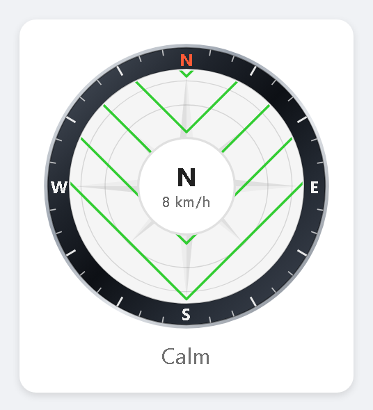

[English](README.md) · [Italiano](README.it.md) · **Deutsch** · [Français](README.fr.md) · [Español](README.es.md) · [Nederlands](README.nl.md)

[](https://my.home-assistant.io/redirect/marketplace_repository/?owner=Nik8003&repository=wind-compass-card&category=plugin) [](https://github.com/Nik8003/wind-compass-card/releases) [](LICENSE)

# Wind Compass Card

Eine Home-Assistant-Karte, die zeigt, **wo Wind und Regen dein Haus treffen**: Windrichtung und -stärke, Regen und wie stark jedes deiner Fenster getroffen wird. Entstanden für einen einfachen Zweck: die Rollläden schließen, wenn der Wind den Regen gegen die Scheiben drückt.

<p align="center">
  
  
</p>

## Was sie zeigt

- **Wind**: Winkel (V-Formen) entlang der Windachse zeigen, wohin der Wind **weht**. Je stärker der Wind, desto dichter werden sie; zwischen 10 und 15 km/h wechseln sie von Grün zu Rot. In der Mitte stehen die Herkunft (z. B. **NNO**) und die Geschwindigkeit.
- **Regen**: Regentropfen fliegen mit dem Wind über den Kompass; je mehr es regnet, desto mehr Tropfen. Der Regen wird auch in Worten beschrieben (*Nieselregen*, *Regen*, *Starkregen*, *Wolkenbruch*) mit der Menge.
- **Deine Fenster**: Jedes sitzt an einer Wand rund um den Kompass, in seiner tatsächlichen Ausrichtung, mit zwei Anzeigen: Die **äußere Hälfte füllt sich blau** mit dem Regen auf der Scheibe, die **innere orange** mit dem Winddruck. Wenn das Blau voll ist, ist es Zeit, die Rollläden zu schließen.
- **Optional**: der traditionelle Name des Windes (Tramontana, Gregale, Scirocco…), ins Zifferblatt gravierte Texte, Messing-Stil, Animation, 6 Sprachen, eigene Farben.

## Galerie

### Windstärke
Die Winkel werden linear mit dem Wind dichter: einer bei 1 km/h, dann immer mehr, bis etwa 45 bei `max_speed`.

| 1 km/h | 8 km/h | 20 km/h | 45 km/h |
|:---:|:---:|:---:|:---:|
|  |  |  |  |

### Regen
Die Anzahl der Tropfen folgt den mm/h; der Text beschreibt den Regen.

| Trocken | 0,5 mm/h | 2 mm/h | 6 mm/h | 12 mm/h |
|:---:|:---:|:---:|:---:|:---:|
|  |  |  |  |  |

### Fenster
Fenster mit gleicher Ausrichtung teilen sich eine Wand. Jedes zeigt Regen (äußere Hälfte) und Wind (innere Hälfte). Mit `icon` fügst du ein Symbol für den Raum hinzu, mit `window_thickness` machst du sie dicker, mit `window_layout: ring` werden sie als Bögen auf dem Ring gezeichnet.

| Fenster | Mit Symbolen (`window_thickness: 20`) | `window_layout: ring` |
|:---:|:---:|:---:|
|  |  |  |

### Texte
Unter dem Kompass (Standard) oder mit `engraved_text: true` ins Zifferblatt graviert, in der Größe, die du mit `engraved_text_size` wählst.

| Unter dem Kompass | Graviert | Graviert, `engraved_text_size: 1.5` |
|:---:|:---:|:---:|
|  |  |  |

### Stile und Themes
Die Karte folgt dem hellen und dunklen Theme von Home Assistant. `theme: brass` macht daraus ein Messinginstrument mit gravierten Winkeln und Tropfen.

| Standard, hell | Standard, dunkel | Messing, hell | Messing, dunkel |
|:---:|:---:|:---:|:---:|
|  |  |  |  |

### Farben der Lünette (Standard-Stil)
`bezel_color` und `bezel_opacity`; Striche und Buchstaben werden von selbst weiß oder dunkel, damit sie lesbar bleiben.

| Standard | `#0d2a4a` | `#e0e4ea` | `#8e1b1b` | `#0d2a4a`, Deckkraft 0.25 |
|:---:|:---:|:---:|:---:|:---:|
|  |  |  |  |  |

### Sprachen
Englisch, Italienisch, Deutsch, Französisch, Spanisch und Niederländisch, automatisch aus Home Assistant oder mit `language`.

| English | Italiano | Deutsch | Français | Español | Nederlands |
|:---:|:---:|:---:|:---:|:---:|:---:|
|  |  |  |  |  |  |

### Weiteres
| Minimale Konfiguration | Klassischer Pfeil (`pointer: arrow`) | Eigene Farben mit card-mod |
|:---:|:---:|:---:|
|  |  |  |

## Installation

### Marketplace (Home Assistant 2026.11 und neuer)

[](https://my.home-assistant.io/redirect/marketplace_repository/?owner=Nik8003&repository=wind-compass-card&category=plugin)

1. Auf die Schaltfläche oben klicken oder **Einstellungen → Marketplace** öffnen, oben rechts das Hinzufügen per Link wählen und `https://github.com/Nik8003/wind-compass-card` eingeben.
2. **Wind Compass Card** (Typ **Dashboard**) installieren und den Browser neu laden.

### HACS (Home Assistant vor 2026.11)

1. HACS → ⋮ → *Benutzerdefinierte Repositories* → `https://github.com/Nik8003/wind-compass-card` hinzufügen, Kategorie **Dashboard**.
2. **Wind Compass Card** installieren und den Browser neu laden.

### Manuell

1. `dist/wind-compass-card.js` nach `<config>/www/wind-compass-card.js` kopieren.
2. Einstellungen → Dashboards → ⋮ → *Ressourcen* → `/local/wind-compass-card.js?v=1` als **JavaScript-Modul** hinzufügen.
3. Browser neu laden. Nach jedem Update der Datei `?v=1` in `?v=2`, `?v=3`… ändern, damit Browser und App die neue Version laden.

## Konfiguration

Nur die beiden Windsensoren sind Pflicht; alles andere hat einen Standardwert:

```yaml
type: custom:wind-compass-card
direction_entity: sensor.wind_direction
speed_entity: sensor.wind_speed
```

Mit `rain_entity` siehst du den Regen, mit `sectors` deine Fenster. Ein ausführlicheres Beispiel:

```yaml
type: custom:wind-compass-card
name: Wind
direction_entity: sensor.wind_direction
speed_entity: sensor.wind_speed
rain_entity: sensor.rain_rate     # mm/h, mm, binary_sensor oder weather
show_wind_name: true
engraved_text: true
window_thickness: 14
sectors:
  - name: Küche
    direction: 0     # Ausrichtung des Fensters (0 = Norden, 90 = Osten)
    width: 120       # tatsächliche Breite des Fensters (z. B. cm), maßstabsgetreu gezeichnet
    icon: mdi:stove  # Symbol des Raums: HA-Icon oder Emoji
  - name: Wohnzimmer
    direction: 0
    width: 200
    icon: mdi:sofa
  - name: Schlafzimmer
    direction: 90
    width: 120
    icon: mdi:bed
```

| Option             | Standard | Beschreibung |
|--------------------|----------|-------------|
| `direction_entity` | **Pflicht** | Sensor der Windrichtung in Grad: woher der Wind **kommt** (0 = Norden, 90 = Osten). |
| `speed_entity`     | **Pflicht** | Sensor der Windgeschwindigkeit (beliebige Einheit). |
| `name`             |          | Titel der Karte (zentriert). |
| `rain_entity`      |          | `binary_sensor` (`on` = Regen), numerischer `sensor` (Regen, wenn > `rain_threshold`) oder `weather`-Entität (Regen-Zustände). |
| `rain_threshold`   | `0`      | Für numerische Regensensoren: Wert, ab dem es als Regen zählt. |
| `rain_levels`      | `[1, 4, 10]` | Grenzen in mm/h für die Beschreibung: unter 1 *Nieselregen*, 1–4 *Regen*, 4–10 *Starkregen*, ab 10 *Wolkenbruch*. |
| `max_rain`         | `15`     | Regen (mm/h), der den Kompass mit Tropfen füllt: die Anzahl der Tropfen wächst linear bis zu diesem Wert. |
| `wall_rain_max`    | `5`      | Regen auf der Scheibe (mm/h), der die Regenanzeige eines Fensters füllt. |
| `min_speed`        | `10`     | Winddruck auf ein Fenster, ab dem er zählt (darunter ist die Windanzeige blass und die Karte zeigt *Windstill*). Gleiche Einheit wie der Sensor. |
| `max_speed`        | `60`     | Geschwindigkeit, bei der die Winkel am dichtesten sind und die Windanzeige eines Fensters voll ist. |
| `sectors`          |          | Liste der Fenster: `name`, `direction` (Ausrichtung, 0–360, **Pflicht**), `width` (tatsächliche Breite in beliebiger Einheit, z. B. cm, Standard 30), `icon` (`mdi:…`-Icon, Emoji oder Buchstabe), `exposure` (0–1, Standard 1: z. B. `0.5` unter einem Balkon). |
| `window_thickness` | `10`     | Dicke der Fenster (6–24). Dickere Fenster lassen mehr Platz für das Symbol. |
| `window_layout`    | `tangent` | `tangent`: Fenster an Wänden rund um den Kompass. `ring`: Fenster als Bögen auf dem Ring (`width` ist dann die Bogengröße in Grad). |
| `show_wind_name`   | `false`  | Zeigt den traditionellen Namen des Windes: Tramontana (N), Gregale (NO), Levante (O), Scirocco (SO), Ostro (S), Libeccio (SW), Ponente (W), Mistral (NW). |
| `engraved_text`    | `false`  | Graviert die Texte ins Zifferblatt statt sie unter den Kompass zu schreiben: der Name des Windes über der Mitte, der Regen am unteren Rand. |
| `engraved_text_size` | `1`    | Größe der gravierten Texte als Faktor (0.5–2.5). |
| `theme`            | `default` | `brass`: polierte Messinglünette, gravierte Winkel und Tropfen, Serifenschrift. |
| `bezel_color`      |          | Standard-Stil: Farbe der Lünette (CSS-Farbe oder `[r, g, b]`). |
| `bezel_opacity`    | `1`      | Standard-Stil: Deckkraft der Lünette, von `0` (unsichtbar) bis `1`. |
| `bezel_text_color` | auto     | Standard-Stil: Farbe der Striche und Buchstaben (standardmäßig weiß oder dunkel, je nachdem was besser lesbar ist). |
| `motion`           | `false`  | Animiert den Kompass: Tropfen fliegen mit dem Wind, Winkel fließen entlang seiner Achse, schneller bei stärkerem Wind. |
| `language`         | `auto`   | `auto` (wie Home Assistant, Englisch falls nicht verfügbar), `en`, `it`, `de`, `fr`, `es`, `nl`. |
| `texts`            |          | Eigene Texte statt der eingebauten (siehe unten). |
| `pointer`          | `chevrons` | `arrow` zeichnet einen Pfeil statt der Winkel. |
| `color`            |          | Feste Farbe für Winkel oder Pfeil statt der geschwindigkeitsabhängigen. |

Die meisten Optionen lassen sich im visuellen Editor einstellen; `sectors` und `texts` werden in YAML bearbeitet. Der visuelle Editor schreibt nur die Optionen, die du änderst, damit das YAML kurz bleibt. Eine leere Option oder ein ungültiger Wert verwendet den Standard. Ein Klick auf die Karte öffnet die Details des Geschwindigkeitssensors.

### Wie die Wirkung auf ein Fenster berechnet wird

Jeder Wind von der Seite des Fensters (weniger als 90° von seiner Ausrichtung entfernt) trifft es, gewichtet mit dem Kosinus des Winkels θ: frontal zählt 100 %, 45° daneben 71 %, 60° daneben 50 %. Bei Wind aus Nordost werden also Nord- und Ostfenster getroffen.

- **Wind auf dem Fenster** = Windgeschwindigkeit × cos θ × `exposure`.
- **Regen auf der Scheibe** (Schlagregen, ISO 15927-3) = `0,222 × Wind [m/s] × Regen^0,88 [mm/h] × cos θ × exposure`. Beispiel: 25 km/h und 2 mm/h bei 45° → etwa 2 mm/h auf der Scheibe.

Liefert der Regensensor keine Menge (binary sensor, Wetter-Entität), werden 2 mm/h angenommen (8 mm/h bei *pouring*).

## Sprachen und eigene Texte

Mit `language: auto` folgt die Karte der Sprache von Home Assistant. Jeder Text lässt sich mit `texts` ersetzen; ersetzt wird nur, was du angibst:

```yaml
texts:
  calm: Flaute
  drizzle: Sprühregen         # unter rain_levels[0]
  raining: Regen              # rain_levels[0] bis [1] (auch wenn der Sensor keine Menge liefert)
  heavy_rain: Starker Regen   # rain_levels[1] bis [2]
  downpour: Platzregen        # ab rain_levels[2]
  dry: Trocken
  unavailable: "—"
  # 16 Himmelsrichtungen, ab N im Uhrzeigersinn
  cardinals: [N, NNO, NO, ONO, O, OSO, SO, SSO, S, SSW, SW, WSW, W, WNW, NW, NNW]
  # 8 Windnamen, für Wind aus N, NO, O, SO, S, SW, W, NW
  wind_names: [Tramontana, Gregale, Levante, Scirocco, Ostro, Libeccio, Ponente, Mistral]
```

`cardinals` braucht 16 Einträge und `wind_names` 8, sonst werden sie ignoriert. Die 4 Buchstaben auf der Lünette sind die Einträge 1, 5, 9 und 13 von `cardinals`.

## Gestaltung (card-mod oder Themes)

Die Karte liest diese CSS-Variablen, du kannst sie also mit [card-mod](https://github.com/thomasloven/lovelace-card-mod) oder einem Home-Assistant-Theme umgestalten:

| Variable | Was sie färbt |
|----------|---------------|
| `--wind-compass-chevron-color` | Windwinkel (statt der geschwindigkeitsabhängigen Farbe) |
| `--wind-compass-drop-color` | Regentropfen |
| `--wind-compass-wind-color` | Wind-Hälfte der Fenster |
| `--wind-compass-rain-color` | Regen-Hälfte der Fenster und Regenanzeige |
| `--wind-compass-face-color` | Zifferblatt |
| `--wind-compass-bezel-color` | Lünette um das Zifferblatt |
| `--wind-compass-bezel-opacity` | Deckkraft der Lünette (0–1) |
| `--wind-compass-bezel-text-color` | Striche und Buchstaben auf der Lünette |
| `--wind-compass-north-color` | Das N auf der Lünette |
| `--wind-compass-window-icon-color` | Raumsymbole auf den Fenstern |
| `--wind-compass-engraved-text-color` | Ins Zifferblatt gravierte Texte |
| `--wind-compass-font` | Schrift aller Texte |
| `--wind-compass-max-width` | Maximale Größe des Kompasses (z. B. `320px`) |

```yaml
card_mod:
  style: |
    ha-card {
      --wind-compass-chevron-color: #8e24aa;
      --wind-compass-rain-color: #00897b;
      --wind-compass-max-width: 320px;
      background: transparent;
      box-shadow: none;
    }
```

## Entwicklung

- `dev/demo.html`: interaktive Testseite mit Reglern für Wind, Regen und alle Optionen (im Browser öffnen).
- `dev/make-screenshots.ps1`: erzeugt alle Bilder dieses README mit Headless-Chrome neu.

## Lizenz

MIT
