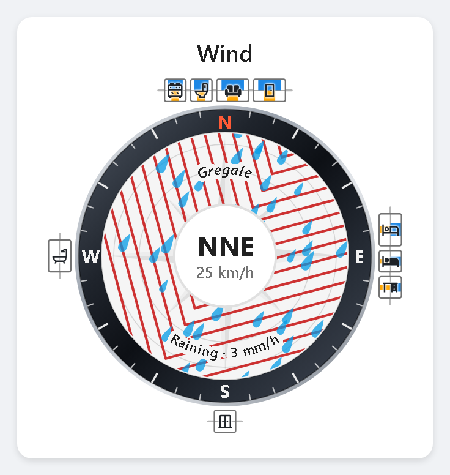
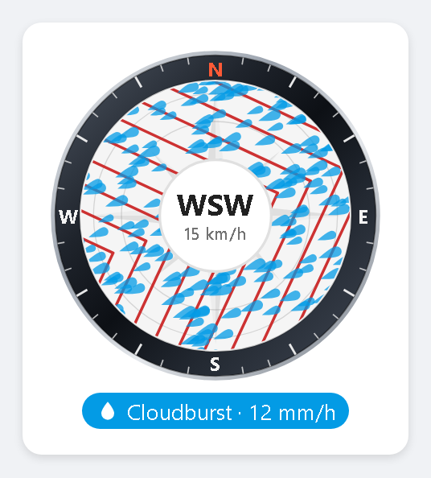
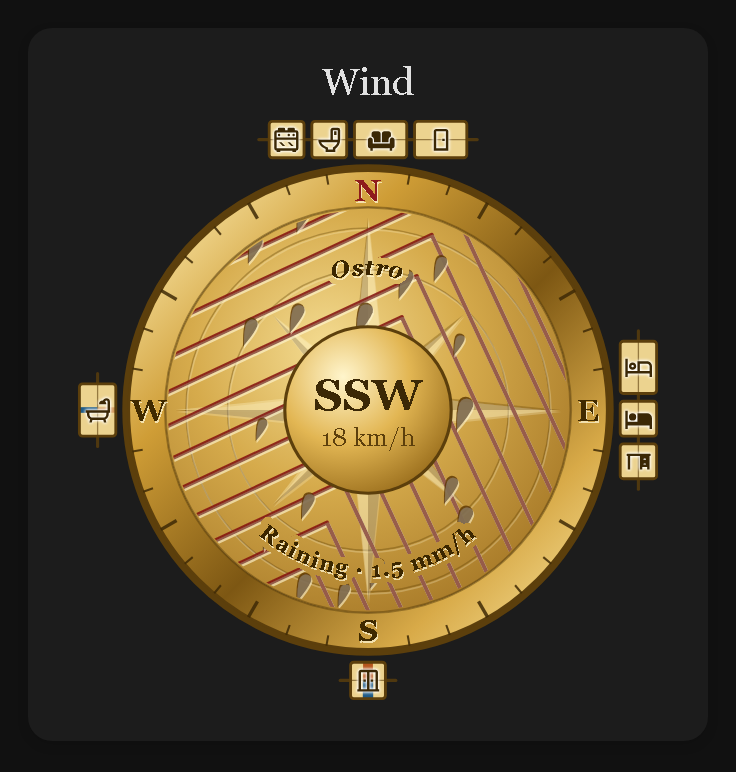
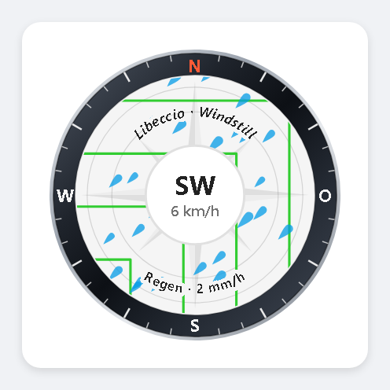

[English](README.md) · [Italiano](README.it.md) · [Deutsch](README.de.md) · [Français](README.fr.md) · **Español** · [Nederlands](README.nl.md)

[](https://my.home-assistant.io/redirect/marketplace_repository/?owner=Nik8003&repository=wind-compass-card&category=plugin) [](https://github.com/Nik8003/wind-compass-card/releases) [](LICENSE)

# Wind Compass Card

Una tarjeta para Home Assistant que muestra **dónde golpean el viento y la lluvia tu casa**: dirección y fuerza del viento, lluvia y cuánto se ve afectada cada una de tus ventanas. Nació de una necesidad sencilla: bajar las persianas cuando el viento empuja la lluvia contra los cristales.

<p align="center">
  
  
</p>

## Qué muestra

- **Viento**: unas uves a lo largo del eje del viento indican hacia dónde **sopla**. Cuanto más fuerte es el viento, más densas son; entre 10 y 15 km/h pasan del verde al rojo. En el centro aparecen la procedencia (p. ej. **NNE**) y la velocidad.
- **Lluvia**: las gotas cruzan la brújula con el viento; cuanto más llueve, más gotas. La lluvia también se describe con palabras (*Llovizna*, *Lluvia*, *Chaparrón*, *Diluvio*) junto con su cantidad.
- **Tus ventanas**: cada una está en una pared alrededor de la brújula, según su orientación real, con dos indicadores: la **mitad exterior se llena de azul** con la lluvia que golpea el cristal, la **mitad interior de naranja** con el empuje del viento. Cuando el azul se llena, es hora de bajar las persianas.
- **Opcional**: el nombre tradicional del viento (Tramontana, Gregal, Siroco…), textos grabados en la esfera, estilo latón, animación, 6 idiomas, colores personalizados.

## Galería

### Fuerza del viento
Las uves se hacen más densas de forma lineal con el viento: una a 1 km/h, luego cada vez más, hasta unas 45 a `max_speed`.

| 1 km/h | 8 km/h | 20 km/h | 45 km/h |
|:---:|:---:|:---:|:---:|
|  |  |  |  |

### Lluvia
El número de gotas sigue los mm/h; el texto describe la lluvia.

| Seco | 0,5 mm/h | 2 mm/h | 6 mm/h | 12 mm/h |
|:---:|:---:|:---:|:---:|:---:|
|  |  |  |  |  |

### Ventanas
Las ventanas orientadas hacia el mismo lado comparten pared. Cada una muestra lluvia (mitad exterior) y viento (mitad interior). Añade un símbolo de la habitación con `icon`, hazlas más gruesas con `window_thickness` o dibújalas como arcos en el anillo con `window_layout: ring`.

| Ventanas | Con iconos (`window_thickness: 20`) | `window_layout: ring` |
|:---:|:---:|:---:|
|  |  |  |

### Textos
Debajo de la brújula (por defecto) o grabados en la esfera con `engraved_text: true`, al tamaño que elijas con `engraved_text_size`.

| Debajo de la brújula | Grabados | Grabados, `engraved_text_size: 1.5` |
|:---:|:---:|:---:|
|  |  |  |

### Estilos y temas
La tarjeta sigue los temas claro y oscuro de Home Assistant. `theme: brass` la convierte en un instrumento de latón con uves y gotas grabadas.

| Estándar, claro | Estándar, oscuro | Latón, claro | Latón, oscuro |
|:---:|:---:|:---:|:---:|
|  |  |  |  |

### Colores del bisel (estilo estándar)
`bezel_color` y `bezel_opacity`; las marcas y letras se vuelven blancas u oscuras solas para seguir siendo legibles.

| Por defecto | `#0d2a4a` | `#e0e4ea` | `#8e1b1b` | `#0d2a4a`, opacidad 0.25 |
|:---:|:---:|:---:|:---:|:---:|
|  |  |  |  |  |

### Idiomas
Inglés, italiano, alemán, francés, español y neerlandés, elegidos automáticamente según Home Assistant o con `language`.

| English | Italiano | Deutsch | Français | Español | Nederlands |
|:---:|:---:|:---:|:---:|:---:|:---:|
|  |  |  |  |  |  |

### Más
| Configuración mínima | Flecha clásica (`pointer: arrow`) | Tus colores con card-mod |
|:---:|:---:|:---:|
|  |  |  |

## Instalación

### Marketplace (Home Assistant 2026.11 y posteriores)

[](https://my.home-assistant.io/redirect/marketplace_repository/?owner=Nik8003&repository=wind-compass-card&category=plugin)

1. Pulsa el botón de arriba, o ve a **Ajustes → Marketplace**, elige añadir desde un enlace (arriba a la derecha) e introduce `https://github.com/Nik8003/wind-compass-card`.
2. Instala **Wind Compass Card** (tipo **Dashboard**) y recarga el navegador.

### HACS (Home Assistant anterior a 2026.11)

1. HACS → ⋮ → *Repositorios personalizados* → añade `https://github.com/Nik8003/wind-compass-card`, categoría **Dashboard**.
2. Instala **Wind Compass Card** y recarga el navegador.

### Manual

1. Copia `dist/wind-compass-card.js` en `<config>/www/wind-compass-card.js`.
2. Ajustes → Paneles de control → ⋮ → *Recursos* → añade `/local/wind-compass-card.js?v=1` como **Módulo JavaScript**.
3. Recarga el navegador. Después de cada actualización del archivo, cambia `?v=1` por `?v=2`, `?v=3`… para que navegadores y app carguen la nueva versión.

## Configuración

Solo los dos sensores de viento son obligatorios; todo lo demás tiene un valor por defecto:

```yaml
type: custom:wind-compass-card
direction_entity: sensor.wind_direction
speed_entity: sensor.wind_speed
```

Añade `rain_entity` para ver la lluvia y `sectors` para ver tus ventanas. Un ejemplo más completo:

```yaml
type: custom:wind-compass-card
name: Viento
direction_entity: sensor.wind_direction
speed_entity: sensor.wind_speed
rain_entity: sensor.rain_rate     # mm/h, mm, binary_sensor o weather
show_wind_name: true
engraved_text: true
window_thickness: 14
sectors:
  - name: Cocina
    direction: 0     # orientación de la ventana (0 = Norte, 90 = Este)
    width: 120       # ancho real de la ventana (p. ej. cm), dibujado a escala
    icon: mdi:stove  # símbolo de la habitación: icono de HA o emoji
  - name: Salón
    direction: 0
    width: 200
    icon: mdi:sofa
  - name: Dormitorio
    direction: 90
    width: 120
    icon: mdi:bed
```

| Opción             | Defecto | Descripción |
|--------------------|---------|-------------|
| `direction_entity` | **obligatoria** | Sensor de dirección del viento en grados: de dónde **viene** (0 = Norte, 90 = Este). |
| `speed_entity`     | **obligatoria** | Sensor de velocidad del viento (cualquier unidad). |
| `name`             |         | Título de la tarjeta (centrado). |
| `rain_entity`      |         | `binary_sensor` (`on` = lluvia), `sensor` numérico (lluvia si > `rain_threshold`) o entidad `weather` (estados de lluvia). |
| `rain_threshold`   | `0`     | Para sensores numéricos: valor a partir del cual se considera lluvia. |
| `rain_levels`      | `[1, 4, 10]` | Límites en mm/h para describir la lluvia: menos de 1 *Llovizna*, 1–4 *Lluvia*, 4–10 *Chaparrón*, desde 10 *Diluvio*. |
| `max_rain`         | `15`    | Lluvia (mm/h) que llena la brújula de gotas: su número crece de forma lineal hasta este valor. |
| `wall_rain_max`    | `5`     | Lluvia en el cristal (mm/h) que llena el indicador de lluvia de una ventana. |
| `min_speed`        | `10`    | Empuje del viento sobre una ventana a partir del cual cuenta (por debajo, el indicador está atenuado y la tarjeta muestra *Calma*). Misma unidad que el sensor. |
| `max_speed`        | `60`    | Velocidad a la que las uves son más densas y el indicador de viento de una ventana está lleno. |
| `sectors`          |         | Lista de ventanas: `name`, `direction` (orientación, 0–360, **obligatoria**), `width` (ancho real en cualquier unidad, p. ej. cm, defecto 30), `icon` (icono `mdi:…`, emoji o letra), `exposure` (0–1, defecto 1: p. ej. `0.5` bajo un balcón). |
| `window_thickness` | `10`    | Grosor de las ventanas (6–24). Ventanas más gruesas dejan más espacio al símbolo. |
| `window_layout`    | `tangent` | `tangent`: ventanas en paredes alrededor de la brújula. `ring`: ventanas como arcos en el anillo (`width` pasa a ser el tamaño del arco en grados). |
| `show_wind_name`   | `false` | Muestra el nombre tradicional del viento: Tramontana (N), Gregal (NE), Levante (E), Siroco (SE), Mediodía (S), Lebeche (SO), Poniente (O), Mistral (NO). |
| `engraved_text`    | `false` | Graba los textos en la esfera en lugar de escribirlos debajo de la brújula: el nombre del viento sobre el centro, la lluvia en la parte inferior. |
| `engraved_text_size` | `1`   | Tamaño de los textos grabados, como multiplicador (0.5–2.5). |
| `theme`            | `default` | `brass`: bisel de latón pulido, uves y gotas grabadas, letras con serifa. |
| `bezel_color`      |         | Estilo estándar: color del bisel (color CSS o `[r, g, b]`). |
| `bezel_opacity`    | `1`     | Estilo estándar: opacidad del bisel, de `0` (invisible) a `1`. |
| `bezel_text_color` | auto    | Estilo estándar: color de marcas y letras (blanco u oscuro por defecto, el más legible). |
| `motion`           | `false` | Anima la brújula: las gotas vuelan con el viento y las uves fluyen a lo largo de su eje, más rápido con viento fuerte. |
| `language`         | `auto`  | `auto` (como Home Assistant, inglés si no está disponible), `en`, `it`, `de`, `fr`, `es`, `nl`. |
| `texts`            |         | Tus propios textos en lugar de los incluidos (ver abajo). |
| `pointer`          | `chevrons` | `arrow` dibuja una flecha en lugar de las uves. |
| `color`            |         | Color fijo para las uves o la flecha, en lugar del que depende de la velocidad. |

La mayoría de las opciones se configuran en el editor visual; `sectors` y `texts` se editan en YAML. El editor visual solo escribe las opciones que cambias, así el YAML sigue siendo corto. Una opción vacía o con un valor no válido usa su valor por defecto. Al hacer clic en la tarjeta se abren los detalles del sensor de velocidad.

### Cómo se calcula el impacto sobre una ventana

Todo viento que llega desde el lado de la ventana (a menos de 90° de su orientación) la golpea, ponderado por el coseno del ángulo θ: de frente cuenta el 100 %, a 45° el 71 %, a 60° el 50 %. Así, con viento del Noreste se ven afectadas las ventanas al Norte y al Este.

- **Viento sobre la ventana** = velocidad del viento × cos θ × `exposure`.
- **Lluvia en el cristal** (lluvia batiente, ISO 15927-3) = `0,222 × viento [m/s] × lluvia^0,88 [mm/h] × cos θ × exposure`. Ejemplo: 25 km/h y 2 mm/h a 45° → unos 2 mm/h en el cristal.

Si el sensor de lluvia no da una cantidad (binary sensor, entidad meteorológica), se asumen 2 mm/h (8 mm/h con *pouring*).

## Idiomas y textos personalizados

Con `language: auto` la tarjeta sigue el idioma de Home Assistant. Cualquier texto se puede sustituir con `texts`; solo se reemplaza lo que indiques:

```yaml
texts:
  calm: Calma chicha
  drizzle: Chirimiri          # por debajo de rain_levels[0]
  raining: Lluvia             # de rain_levels[0] a [1] (también si el sensor no da una cantidad)
  heavy_rain: Lluvia fuerte   # de rain_levels[1] a [2]
  downpour: A cántaros        # desde rain_levels[2]
  dry: Seco
  unavailable: "—"
  # 16 puntos cardinales, desde N en el sentido de las agujas del reloj
  cardinals: [N, NNE, NE, ENE, E, ESE, SE, SSE, S, SSO, SO, OSO, O, ONO, NO, NNO]
  # 8 nombres de viento, para viento del N, NE, E, SE, S, SO, O, NO
  wind_names: [Tramontana, Gregal, Levante, Siroco, Mediodía, Lebeche, Poniente, Mistral]
```

`cardinals` debe tener 16 elementos y `wind_names` 8; si no, se ignoran. Las 4 letras del bisel son los elementos 1, 5, 9 y 13 de `cardinals`.

## Estilo (card-mod o temas)

La tarjeta lee estas variables CSS, así que puedes cambiar su aspecto con [card-mod](https://github.com/thomasloven/lovelace-card-mod) o con un tema de Home Assistant:

| Variable | Qué colorea |
|----------|-------------|
| `--wind-compass-chevron-color` | Uves del viento (en lugar del color según la velocidad) |
| `--wind-compass-drop-color` | Gotas de lluvia |
| `--wind-compass-wind-color` | Mitad de «viento» de las ventanas |
| `--wind-compass-rain-color` | Mitad de «lluvia» de las ventanas e indicador de lluvia |
| `--wind-compass-face-color` | Esfera |
| `--wind-compass-bezel-color` | Bisel alrededor de la esfera |
| `--wind-compass-bezel-opacity` | Opacidad del bisel (0–1) |
| `--wind-compass-bezel-text-color` | Marcas y letras del bisel |
| `--wind-compass-north-color` | La N del bisel |
| `--wind-compass-window-icon-color` | Símbolos de las habitaciones en las ventanas |
| `--wind-compass-engraved-text-color` | Textos grabados en la esfera |
| `--wind-compass-font` | Fuente de todos los textos |
| `--wind-compass-max-width` | Tamaño máximo de la brújula (p. ej. `320px`) |

```yaml
card_mod:
  style: |
    ha-card {
      --wind-compass-chevron-color: #8e24aa;
      --wind-compass-rain-color: #00897b;
      --wind-compass-max-width: 320px;
      background: transparent;
      box-shadow: none;
    }
```

## Desarrollo

- `dev/demo.html`: página de prueba interactiva con controles para viento, lluvia y todas las opciones (ábrela en un navegador).
- `dev/make-screenshots.ps1`: regenera todas las imágenes de este README con Chrome headless.

## Licencia

MIT
