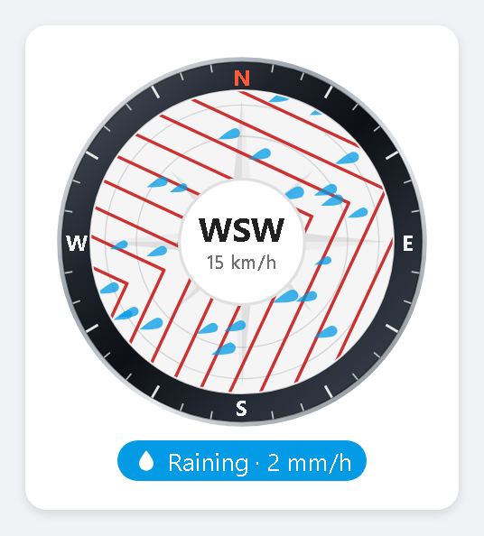
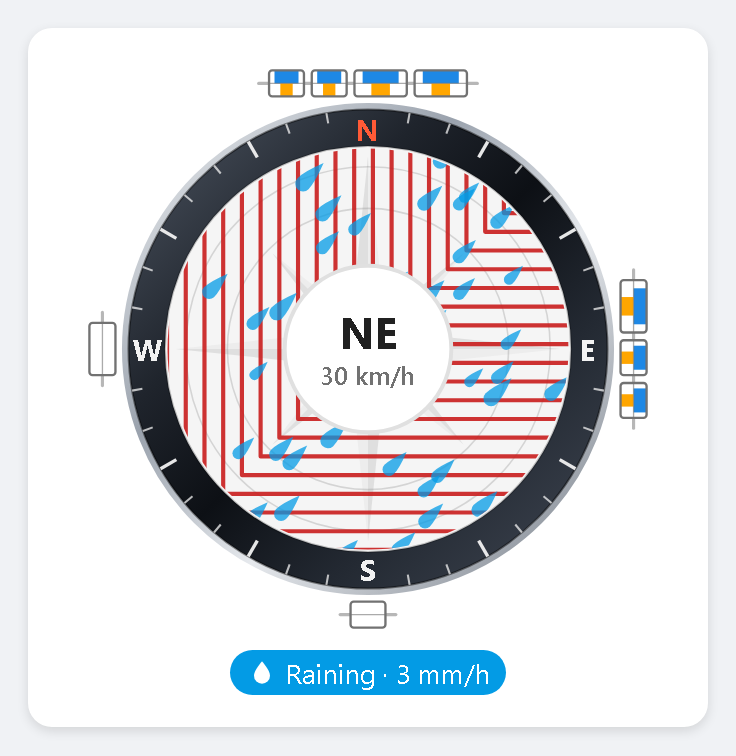
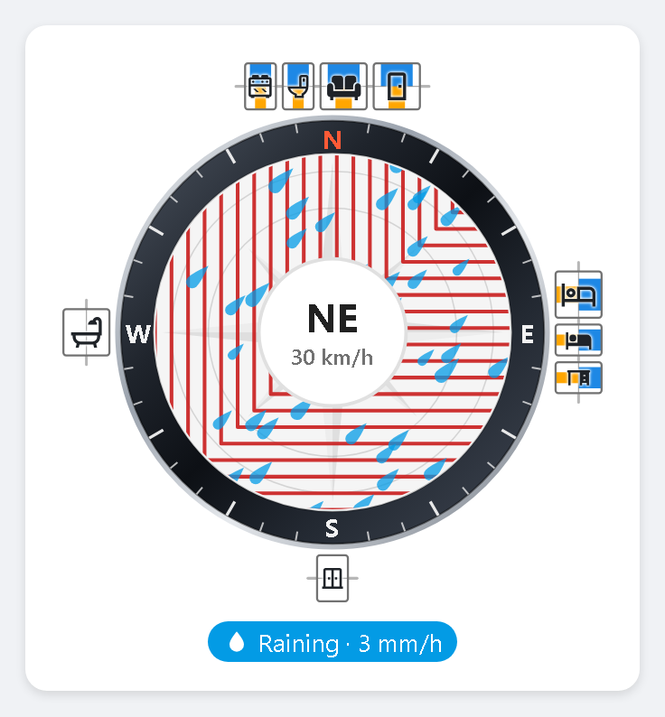
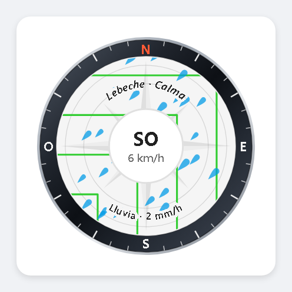

[English](README.md) · [Italiano](README.it.md) · [Deutsch](README.de.md) · **Français** · [Español](README.es.md) · [Nederlands](README.nl.md)

[](https://my.home-assistant.io/redirect/marketplace_repository/?owner=Nik8003&repository=wind-compass-card&category=plugin) [](https://github.com/Nik8003/wind-compass-card/releases) [](LICENSE)

# Wind Compass Card

Une carte Home Assistant qui montre **où le vent et la pluie frappent votre maison** : direction et force du vent, pluie, et à quel point chacune de vos fenêtres est touchée. Née d'un besoin simple : fermer les volets quand le vent pousse la pluie contre les vitres.

<p align="center">
  
  
</p>

## Ce qu'elle montre

- **Le vent** : des chevrons (formes en V) le long de l'axe du vent indiquent où il **souffle**. Plus le vent est fort, plus ils sont serrés ; entre 10 et 15 km/h ils passent du vert au rouge. Au centre : la provenance (ex. **NNE**) et la vitesse.
- **La pluie** : des gouttes traversent la boussole avec le vent ; plus il pleut, plus il y a de gouttes. La pluie est aussi décrite en mots (*Bruine*, *Pluie*, *Averse*, *Déluge*) avec sa quantité.
- **Vos fenêtres** : chacune est placée sur un mur autour de la boussole, selon son orientation réelle, avec deux jauges : la **moitié extérieure se remplit de bleu** avec la pluie qui frappe la vitre, la **moitié intérieure d'orange** avec la poussée du vent. Quand le bleu est plein, il est temps de fermer les volets.
- **En option** : le nom traditionnel du vent (Tramontane, Grégal, Sirocco…), textes gravés dans le cadran, style laiton, animation, 6 langues, couleurs personnalisées.

## Galerie

### Force du vent
Les chevrons se resserrent linéairement avec le vent : un seul à 1 km/h, puis de plus en plus, jusqu'à environ 45 à `max_speed`.

| 1 km/h | 8 km/h | 20 km/h | 45 km/h |
|:---:|:---:|:---:|:---:|
|  |  |  |  |

### Pluie
Le nombre de gouttes suit les mm/h ; le texte décrit la pluie.

| Sec | 0,5 mm/h | 2 mm/h | 6 mm/h | 12 mm/h |
|:---:|:---:|:---:|:---:|:---:|
|  |  |  |  |  |

### Fenêtres
Les fenêtres orientées dans la même direction partagent un mur. Chacune montre la pluie (moitié extérieure) et le vent (moitié intérieure). Ajoutez un symbole de la pièce avec `icon`, épaississez-les avec `window_thickness`, ou dessinez-les en arcs sur l'anneau avec `window_layout: ring`.

| Fenêtres | Avec icônes (`window_thickness: 20`) | `window_layout: ring` |
|:---:|:---:|:---:|
|  |  |  |

### Textes
Sous la boussole (par défaut), ou gravés dans le cadran avec `engraved_text: true`, à la taille choisie avec `engraved_text_size`.

| Sous la boussole | Gravés | Gravés, `engraved_text_size: 1.5` |
|:---:|:---:|:---:|
|  |  |  |

### Styles et thèmes
La carte suit les thèmes clair et sombre de Home Assistant. `theme: brass` en fait un instrument en laiton avec chevrons et gouttes gravés.

| Standard, clair | Standard, sombre | Laiton, clair | Laiton, sombre |
|:---:|:---:|:---:|:---:|
|  |  |  |  |

### Couleurs de la lunette (style standard)
`bezel_color` et `bezel_opacity` ; graduations et lettres passent d'elles-mêmes en blanc ou en foncé pour rester lisibles.

| Par défaut | `#0d2a4a` | `#e0e4ea` | `#8e1b1b` | `#0d2a4a`, opacité 0.25 |
|:---:|:---:|:---:|:---:|:---:|
|  |  |  |  |  |

### Langues
Anglais, italien, allemand, français, espagnol et néerlandais, choisis automatiquement d'après Home Assistant ou avec `language`.

| English | Italiano | Deutsch | Français | Español | Nederlands |
|:---:|:---:|:---:|:---:|:---:|:---:|
|  |  |  |  |  |  |

### Plus
| Configuration minimale | Flèche classique (`pointer: arrow`) | Vos couleurs avec card-mod |
|:---:|:---:|:---:|
|  |  |  |

## Installation

### Marketplace (Home Assistant 2026.11 et plus récent)

[](https://my.home-assistant.io/redirect/marketplace_repository/?owner=Nik8003&repository=wind-compass-card&category=plugin)

1. Cliquez sur le bouton ci-dessus, ou ouvrez **Paramètres → Marketplace**, choisissez l'ajout par lien (en haut à droite) et saisissez `https://github.com/Nik8003/wind-compass-card`.
2. Installez **Wind Compass Card** (type **Dashboard**) et rechargez le navigateur.

### HACS (Home Assistant avant 2026.11)

1. HACS → ⋮ → *Dépôts personnalisés* → ajoutez `https://github.com/Nik8003/wind-compass-card`, catégorie **Dashboard**.
2. Installez **Wind Compass Card** et rechargez le navigateur.

### Manuelle

1. Copiez `dist/wind-compass-card.js` dans `<config>/www/wind-compass-card.js`.
2. Paramètres → Tableaux de bord → ⋮ → *Ressources* → ajoutez `/local/wind-compass-card.js?v=1` comme **Module JavaScript**.
3. Rechargez le navigateur. Après chaque mise à jour du fichier, changez `?v=1` en `?v=2`, `?v=3`… pour que navigateurs et application chargent la nouvelle version.

## Configuration

Seuls les deux capteurs de vent sont obligatoires ; tout le reste a une valeur par défaut :

```yaml
type: custom:wind-compass-card
direction_entity: sensor.wind_direction
speed_entity: sensor.wind_speed
```

Ajoutez `rain_entity` pour voir la pluie et `sectors` pour voir vos fenêtres. Un exemple plus complet :

```yaml
type: custom:wind-compass-card
name: Vent
direction_entity: sensor.wind_direction
speed_entity: sensor.wind_speed
rain_entity: sensor.rain_rate     # mm/h, mm, binary_sensor ou weather
show_wind_name: true
engraved_text: true
window_thickness: 14
sectors:
  - name: Cuisine
    direction: 0     # orientation de la fenêtre (0 = Nord, 90 = Est)
    width: 120       # largeur réelle de la fenêtre (ex. cm), dessinée à l'échelle
    icon: mdi:stove  # symbole de la pièce : icône HA ou emoji
  - name: Salon
    direction: 0
    width: 200
    icon: mdi:sofa
  - name: Chambre
    direction: 90
    width: 120
    icon: mdi:bed
```

| Option             | Défaut | Description |
|--------------------|--------|-------------|
| `direction_entity` | **obligatoire** | Capteur de direction du vent en degrés : d'où le vent **vient** (0 = Nord, 90 = Est). |
| `speed_entity`     | **obligatoire** | Capteur de vitesse du vent (toute unité). |
| `name`             |        | Titre de la carte (centré). |
| `rain_entity`      |        | `binary_sensor` (`on` = pluie), `sensor` numérique (pluie si > `rain_threshold`) ou entité `weather` (états pluvieux). |
| `rain_threshold`   | `0`    | Pour les capteurs numériques : valeur au-delà de laquelle il pleut. |
| `rain_levels`      | `[1, 4, 10]` | Seuils en mm/h pour décrire la pluie : sous 1 *Bruine*, 1–4 *Pluie*, 4–10 *Averse*, dès 10 *Déluge*. |
| `max_rain`         | `15`   | Pluie (mm/h) qui remplit la boussole de gouttes : leur nombre croît linéairement jusqu'à cette valeur. |
| `wall_rain_max`    | `5`    | Pluie sur la vitre (mm/h) qui remplit la jauge de pluie d'une fenêtre. |
| `min_speed`        | `10`   | Poussée du vent sur une fenêtre à partir de laquelle elle compte (en dessous, la jauge est pâle et la carte affiche *Calme*). Même unité que le capteur. |
| `max_speed`        | `60`   | Vitesse à laquelle les chevrons sont les plus serrés et la jauge de vent d'une fenêtre est pleine. |
| `sectors`          |        | Liste des fenêtres : `name`, `direction` (orientation, 0–360, **obligatoire**), `width` (largeur réelle dans toute unité, ex. cm, défaut 30), `icon` (icône `mdi:…`, emoji ou lettre), `exposure` (0–1, défaut 1 : ex. `0.5` sous un balcon). |
| `window_thickness` | `10`   | Épaisseur des fenêtres (6–24). Des fenêtres plus épaisses laissent plus de place au symbole. |
| `window_layout`    | `tangent` | `tangent` : fenêtres sur des murs autour de la boussole. `ring` : fenêtres en arcs sur l'anneau (`width` devient la taille de l'arc en degrés). |
| `show_wind_name`   | `false` | Affiche le nom traditionnel du vent : Tramontane (N), Grégal (NE), Levant (E), Sirocco (SE), Ostro (S), Libeccio (SO), Ponant (O), Mistral (NO). |
| `engraved_text`    | `false` | Grave les textes dans le cadran au lieu de les écrire sous la boussole : le nom du vent au-dessus du centre, la pluie en bas. |
| `engraved_text_size` | `1`  | Taille des textes gravés, en multiplicateur (0.5–2.5). |
| `theme`            | `default` | `brass` : lunette en laiton poli, chevrons et gouttes gravés, lettres à empattements. |
| `bezel_color`      |        | Style standard : couleur de la lunette (couleur CSS ou `[r, g, b]`). |
| `bezel_opacity`    | `1`    | Style standard : opacité de la lunette, de `0` (invisible) à `1`. |
| `bezel_text_color` | auto   | Style standard : couleur des graduations et lettres (blanc ou foncé par défaut, le plus lisible). |
| `motion`           | `false` | Anime la boussole : les gouttes volent avec le vent, les chevrons défilent le long de son axe, plus vite par vent fort. |
| `language`         | `auto` | `auto` (comme Home Assistant, anglais sinon), `en`, `it`, `de`, `fr`, `es`, `nl`. |
| `texts`            |        | Vos propres textes à la place de ceux inclus (voir plus bas). |
| `pointer`          | `chevrons` | `arrow` dessine une flèche à la place des chevrons. |
| `color`            |        | Couleur fixe pour les chevrons ou la flèche, au lieu de celle liée à la vitesse. |

La plupart des options se règlent dans l'éditeur visuel ; `sectors` et `texts` se modifient en YAML. L'éditeur visuel n'écrit que les options que vous changez, le YAML reste donc court. Une option vide ou invalide prend sa valeur par défaut. Un clic sur la carte ouvre les détails du capteur de vitesse.

### Comment l'impact sur une fenêtre est calculé

Tout vent venant du côté de la fenêtre (à moins de 90° de son orientation) la frappe, pondéré par le cosinus de l'angle θ : de face 100 %, à 45° 71 %, à 60° 50 %. Avec un vent de Nord-Est, les fenêtres au Nord et à l'Est sont donc touchées.

- **Vent sur la fenêtre** = vitesse du vent × cos θ × `exposure`.
- **Pluie sur la vitre** (pluie battante, ISO 15927-3) = `0,222 × vent [m/s] × pluie^0,88 [mm/h] × cos θ × exposure`. Exemple : 25 km/h et 2 mm/h à 45° → environ 2 mm/h sur la vitre.

Si le capteur de pluie ne donne pas de quantité (binary sensor, entité météo), on suppose 2 mm/h (8 mm/h avec *pouring*).

## Langues et textes personnalisés

Avec `language: auto`, la carte suit la langue de Home Assistant. Tout texte peut être remplacé avec `texts` ; seul ce que vous indiquez est remplacé :

```yaml
texts:
  calm: Pétole
  drizzle: Crachin            # sous rain_levels[0]
  raining: Pluie              # de rain_levels[0] à [1] (aussi quand le capteur ne donne pas de quantité)
  heavy_rain: Forte pluie     # de rain_levels[1] à [2]
  downpour: Trombes d'eau     # dès rain_levels[2]
  dry: Sec
  unavailable: "—"
  # 16 points cardinaux, de N dans le sens horaire
  cardinals: [N, NNE, NE, ENE, E, ESE, SE, SSE, S, SSO, SO, OSO, O, ONO, NO, NNO]
  # 8 noms de vents, pour un vent du N, NE, E, SE, S, SO, O, NO
  wind_names: [Tramontane, Grégal, Levant, Sirocco, Ostro, Libeccio, Ponant, Mistral]
```

`cardinals` doit avoir 16 éléments et `wind_names` 8, sinon ils sont ignorés. Les 4 lettres de la lunette sont les éléments 1, 5, 9 et 13 de `cardinals`.

## Apparence (card-mod ou thèmes)

La carte lit ces variables CSS, vous pouvez donc la personnaliser avec [card-mod](https://github.com/thomasloven/lovelace-card-mod) ou un thème Home Assistant :

| Variable | Ce qu'elle colore |
|----------|-------------------|
| `--wind-compass-chevron-color` | Chevrons du vent (à la place de la couleur liée à la vitesse) |
| `--wind-compass-drop-color` | Gouttes de pluie |
| `--wind-compass-wind-color` | Moitié « vent » des fenêtres |
| `--wind-compass-rain-color` | Moitié « pluie » des fenêtres et badge de pluie |
| `--wind-compass-face-color` | Cadran |
| `--wind-compass-bezel-color` | Lunette autour du cadran |
| `--wind-compass-bezel-opacity` | Opacité de la lunette (0–1) |
| `--wind-compass-bezel-text-color` | Graduations et lettres de la lunette |
| `--wind-compass-north-color` | Le N de la lunette |
| `--wind-compass-window-icon-color` | Symboles des pièces sur les fenêtres |
| `--wind-compass-engraved-text-color` | Textes gravés dans le cadran |
| `--wind-compass-font` | Police de tous les textes |
| `--wind-compass-max-width` | Taille maximale de la boussole (ex. `320px`) |

```yaml
card_mod:
  style: |
    ha-card {
      --wind-compass-chevron-color: #8e24aa;
      --wind-compass-rain-color: #00897b;
      --wind-compass-max-width: 320px;
      background: transparent;
      box-shadow: none;
    }
```

## Développement

- `dev/demo.html` : page de test interactive avec curseurs pour le vent, la pluie et toutes les options (à ouvrir dans un navigateur).
- `dev/make-screenshots.ps1` : régénère toutes les images de ce README avec Chrome headless.

## Licence

MIT
