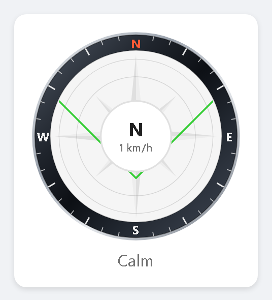
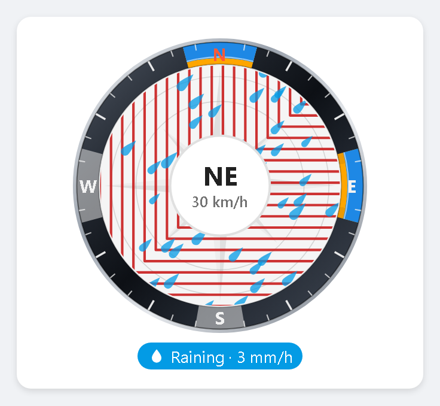
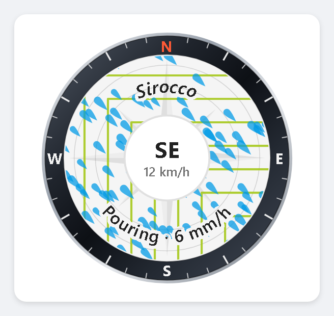
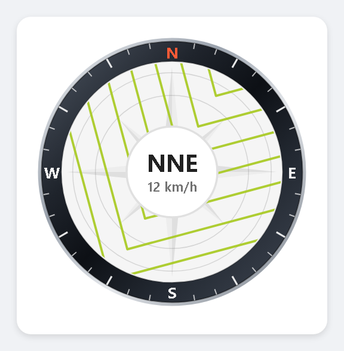
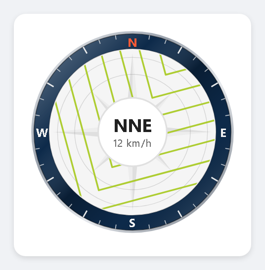
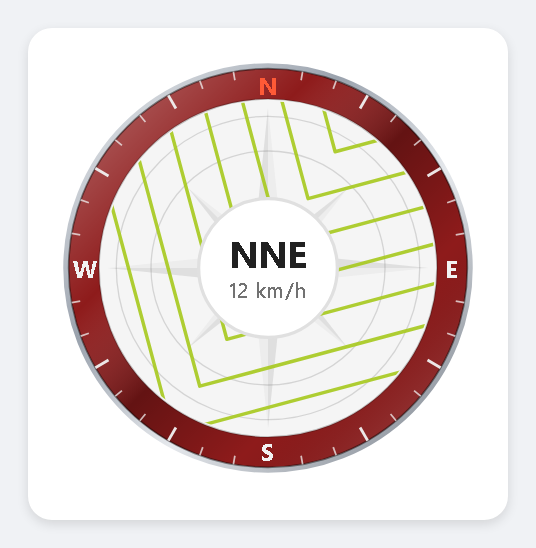
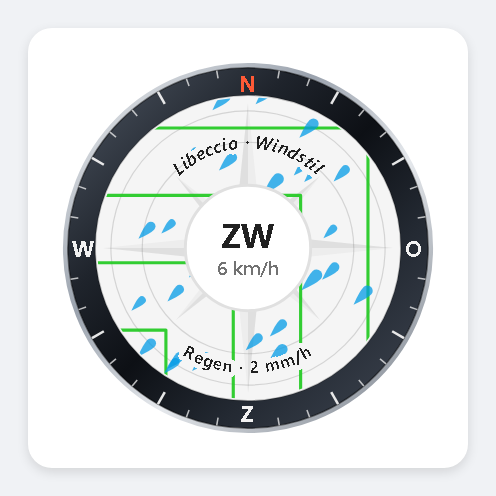
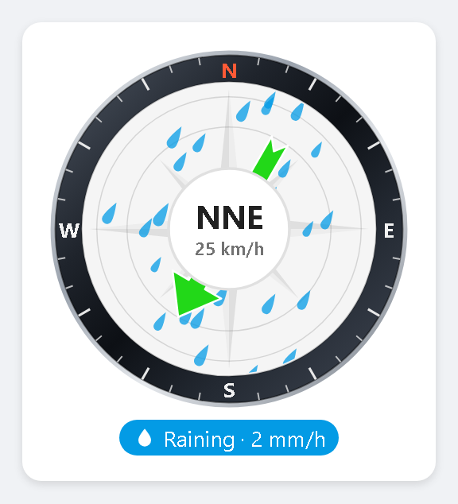

[English](README.md) · **Italiano** · [Deutsch](README.de.md) · [Français](README.fr.md) · [Español](README.es.md) · [Nederlands](README.nl.md)

[](https://my.home-assistant.io/redirect/marketplace_repository/?owner=Nik8003&repository=wind-rain-compass-card&category=plugin) [](https://github.com/Nik8003/wind-rain-compass-card/releases) [](LICENSE)

# Wind Rain Compass Card

Una card per Home Assistant che mostra **dove vento e pioggia colpiscono la tua casa**: direzione e forza del vento, pioggia e quanto ogni finestra viene colpita. Nata per un'esigenza semplice: chiudere le tapparelle quando il vento spinge la pioggia sui vetri.

<p align="center">
  
  
</p>

## Cosa mostra

- **Vento**: delle V lungo l'asse del vento indicano dove **soffia**. Più il vento è forte, più sono fitte; tra 10 e 15 km/h passano dal verde al rosso. Al centro c'è la provenienza (es. **NNE**) con la velocità.
- **Pioggia**: le gocce attraversano la bussola con il vento; più piove, più gocce. La pioggia è anche descritta a parole (*Pioviggina*, *Piove*, *Diluvia*, *Secchiate*) con i mm/h.
- **Le tue finestre**: ognuna sta su un muro attorno alla bussola, nella sua esposizione reale, con due indicatori: la **metà esterna si riempie di blu** con la pioggia che colpisce il vetro, la **metà interna di arancione** con il vento che ci spinge sopra. Quando il blu si riempie, è ora di chiudere le tapparelle.
- **Opzionali**: il nome tradizionale del vento (Tramontana, Grecale, Scirocco…), testi incisi nel quadrante, stile ottone, animazione, 6 lingue, colori personalizzati.

## Galleria

### Forza del vento
Le V si infittiscono in modo lineare con il vento: una a 1 km/h, poi sempre di più, fino a circa 45 a `max_speed`.

| 1 km/h | 8 km/h | 20 km/h | 45 km/h |
|:---:|:---:|:---:|:---:|
|  |  |  |  |

### Pioggia
Il numero di gocce segue i mm/h; il testo descrive la pioggia.

| Asciutto | 0,5 mm/h | 2 mm/h | 6 mm/h | 12 mm/h |
|:---:|:---:|:---:|:---:|:---:|
|  |  |  |  |  |

### Finestre
Le finestre rivolte nella stessa direzione stanno sullo stesso muro. Ognuna mostra pioggia (metà esterna) e vento (metà interna). Aggiungi un simbolo della stanza con `icon`, rendile più spesse con `window_thickness`, oppure disegnale come archi sull'anello con `window_layout: ring`.

| Finestre | Con icone (`window_thickness: 20`) | `window_layout: ring` |
|:---:|:---:|:---:|
|  |  |  |

### Testi
Sotto la bussola (default) oppure incisi nel quadrante con `engraved_text: true`, nella dimensione che scegli con `engraved_text_size`.

| Sotto la bussola | Incisi | Incisi, `engraved_text_size: 1.5` |
|:---:|:---:|:---:|
|  |  |  |

### Stili e temi
La card segue i temi chiaro e scuro di Home Assistant. `theme: brass` la trasforma in uno strumento d'ottone con V e gocce incise.

| Standard, chiaro | Standard, scuro | Ottone, chiaro | Ottone, scuro |
|:---:|:---:|:---:|:---:|
|  |  |  |  |

### Colori della ghiera (stile standard)
`bezel_color` e `bezel_opacity`; tacche e lettere diventano bianche o scure da sole per restare leggibili.

| Default | `#0d2a4a` | `#e0e4ea` | `#8e1b1b` | `#0d2a4a`, opacità 0.25 |
|:---:|:---:|:---:|:---:|:---:|
|  |  |  |  |  |

### Lingue
Inglese, italiano, tedesco, francese, spagnolo e olandese, scelte automaticamente da Home Assistant o con `language`.

| English | Italiano | Deutsch | Français | Español | Nederlands |
|:---:|:---:|:---:|:---:|:---:|:---:|
|  |  |  |  |  |  |

### Altro
| Configurazione minima | Freccia classica (`pointer: arrow`) | I tuoi colori con card-mod |
|:---:|:---:|:---:|
|  |  |  |

## Installazione

### Marketplace (Home Assistant 2026.11 e successivi)

[](https://my.home-assistant.io/redirect/marketplace_repository/?owner=Nik8003&repository=wind-rain-compass-card&category=plugin)

1. Clicca il pulsante qui sopra, oppure vai in **Impostazioni → Marketplace**, scegli di aggiungere da link (in alto a destra) e inserisci `https://github.com/Nik8003/wind-rain-compass-card`.
2. Installa **Wind Rain Compass Card** (tipo **Dashboard**) e ricarica il browser.

### HACS (Home Assistant prima della 2026.11)

1. HACS → ⋮ → *Repository personalizzati* → aggiungi `https://github.com/Nik8003/wind-rain-compass-card`, categoria **Dashboard**.
2. Installa **Wind Rain Compass Card** e ricarica il browser.

### Manuale

1. Copia `dist/wind-rain-compass-card.js` in `<config>/www/wind-rain-compass-card.js`.
2. Impostazioni → Dashboard → ⋮ → *Risorse* → aggiungi `/local/wind-rain-compass-card.js?v=1` come **Modulo JavaScript**.
3. Ricarica il browser. A ogni aggiornamento del file cambia `?v=1` in `?v=2`, `?v=3`… così browser e app caricano la nuova versione.

## Configurazione

Servono solo i due sensori del vento; tutto il resto ha un valore predefinito:

```yaml
type: custom:wind-rain-compass-card
direction_entity: sensor.wind_direction
speed_entity: sensor.wind_speed
```

Aggiungi `rain_entity` per vedere la pioggia e `sectors` per vedere le tue finestre. Un esempio più completo:

```yaml
type: custom:wind-rain-compass-card
name: Vento
direction_entity: sensor.wind_direction
speed_entity: sensor.wind_speed
rain_entity: sensor.rain_rate     # mm/h, mm, binary_sensor o weather
show_wind_name: true
engraved_text: true
window_thickness: 14
sectors:
  - name: Cucina
    direction: 0     # verso cui è rivolta la finestra (0 = Nord, 90 = Est)
    width: 120       # larghezza reale della finestra (es. cm), disegnata in proporzione
    icon: mdi:stove  # simbolo della stanza: icona HA o emoji
  - name: Soggiorno
    direction: 0
    width: 200
    icon: mdi:sofa
  - name: Camera
    direction: 90
    width: 120
    icon: mdi:bed
```

| Opzione            | Default | Descrizione |
|--------------------|---------|-------------|
| `direction_entity` | **obbligatoria** | Sensore della direzione del vento in gradi: da dove **arriva** (0 = Nord, 90 = Est). |
| `speed_entity`     | **obbligatoria** | Sensore della velocità del vento (qualsiasi unità). |
| `name`             |         | Titolo della card (centrato). |
| `rain_entity`      |         | `binary_sensor` (`on` = piove), `sensor` numerico (piove se > `rain_threshold`) o entità `weather` (stati piovosi). |
| `rain_threshold`   | `0`     | Per i sensori numerici: valore oltre il quale si considera pioggia. |
| `rain_levels`      | `[1, 4, 10]` | Soglie in mm/h per descrivere la pioggia: sotto 1 *Pioviggina*, 1–4 *Piove*, 4–10 *Diluvia*, da 10 *Secchiate*. |
| `max_rain`         | `15`    | Pioggia (mm/h) che riempie la bussola di gocce: il numero di gocce cresce in modo lineare fino a questo valore. |
| `wall_rain_max`    | `5`     | Pioggia sul vetro (mm/h) che riempie l'indicatore pioggia di una finestra. |
| `min_speed`        | `10`    | Vento che spinge su una finestra da cui inizia a contare (sotto, l'indicatore vento è sbiadito e la card mostra *Calma*). Stessa unità del sensore. |
| `max_speed`        | `60`    | Velocità a cui le V sono più fitte e l'indicatore vento di una finestra è pieno. |
| `sectors`          |         | Lista delle finestre: `name`, `direction` (verso cui è rivolta, 0–360, **obbligatoria**), `width` (larghezza reale in qualsiasi unità, es. cm, default 30), `icon` (icona `mdi:…`, emoji o lettera), `exposure` (0–1, default 1: es. `0.5` sotto un balcone). |
| `window_thickness` | `10`    | Spessore delle finestre (6–24). Finestre più spesse lasciano più spazio al simbolo. |
| `window_layout`    | `tangent` | `tangent`: finestre sui muri attorno alla bussola. `ring`: finestre come archi sull'anello (`width` diventa l'ampiezza in gradi). |
| `show_wind_name`   | `false` | Mostra il nome tradizionale del vento: Tramontana (N), Grecale (NE), Levante (E), Scirocco (SE), Ostro (S), Libeccio (SO), Ponente (O), Maestrale (NO). |
| `engraved_text`    | `false` | Incide i testi nel quadrante invece di scriverli sotto la bussola: il nome del vento sopra il centro, la pioggia lungo il fondo. |
| `engraved_text_size` | `1`   | Dimensione dei testi incisi, come moltiplicatore (0.5–2.5). |
| `theme`            | `default` | `brass`: ghiera d'ottone lucido, V e gocce incise, caratteri con grazie. |
| `bezel_color`      |         | Stile standard: colore della ghiera (colore CSS o `[r, g, b]`). |
| `bezel_opacity`    | `1`     | Stile standard: opacità della ghiera, da `0` (invisibile) a `1`. |
| `bezel_text_color` | auto    | Stile standard: colore di tacche e lettere (di default bianco o scuro, quello più leggibile). |
| `motion`           | `false` | Anima la bussola: le gocce volano con il vento e le V scorrono lungo il suo asse, più veloci con vento forte. |
| `language`         | `auto`  | `auto` (come Home Assistant, inglese se non disponibile), `en`, `it`, `de`, `fr`, `es`, `nl`. |
| `texts`            |         | I tuoi testi, al posto di quelli inclusi (vedi sotto). |
| `pointer`          | `chevrons` | `arrow` disegna una freccia al posto delle V. |
| `color`            |         | Colore fisso per le V o la freccia, invece di quello legato alla velocità. |

Quasi tutte le opzioni si impostano dall'editor visuale; `sectors` e `texts` si modificano in YAML. L'editor visuale scrive solo le opzioni che cambi, quindi il YAML resta corto. Un'opzione vuota o con un valore non valido usa il default. Cliccando la card si aprono i dettagli del sensore della velocità.

### Come si calcola l'impatto su una finestra

Ogni vento che arriva dal lato della finestra (a meno di 90° dalla direzione verso cui è rivolta) la colpisce, pesato con il coseno dell'angolo θ: frontale conta il 100%, a 45° il 71%, a 60° il 50%. Quindi con vento da Nord-Est vengono colpite sia le finestre a Nord sia quelle a Est.

- **Vento sulla finestra** = velocità del vento × cos θ × `exposure`.
- **Pioggia sul vetro** (pioggia battente, ISO 15927-3) = `0,222 × vento [m/s] × pioggia^0,88 [mm/h] × cos θ × exposure`. Esempio: 25 km/h e 2 mm/h a 45° → circa 2 mm/h sul vetro.

Se il sensore pioggia non fornisce una quantità (binary sensor, entità meteo), si assumono 2 mm/h (8 mm/h con *pouring*).

## Lingue e testi personalizzati

Con `language: auto` la card segue la lingua di Home Assistant. Ogni testo si può sostituire con `texts`; viene sostituito solo quello che imposti:

```yaml
texts:
  calm: Bonaccia
  drizzle: Pioggerellina      # sotto rain_levels[0]
  raining: Piove              # da rain_levels[0] a [1] (anche se il sensore non dà una quantità)
  heavy_rain: Piove forte     # da rain_levels[1] a [2]
  downpour: A catinelle       # da rain_levels[2]
  dry: Secco
  unavailable: "—"
  # 16 punti cardinali, da N in senso orario
  cardinals: [N, NNE, NE, ENE, E, ESE, SE, SSE, S, SSO, SO, OSO, O, ONO, NO, NNO]
  # 8 nomi dei venti, per vento da N, NE, E, SE, S, SO, O, NO
  wind_names: [Tramontana, Grecale, Levante, Scirocco, Mezzogiorno, Garbino, Ponente, Maestrale]
```

`cardinals` deve avere 16 elementi e `wind_names` 8, altrimenti vengono ignorati. Le 4 lettere sulla ghiera sono gli elementi 1, 5, 9 e 13 di `cardinals`.

## Stile (card-mod o temi)

La card legge queste variabili CSS, quindi puoi modificarne l'aspetto con [card-mod](https://github.com/thomasloven/lovelace-card-mod) o da un tema di Home Assistant:

| Variabile | Cosa colora |
|----------|-------------|
| `--wind-compass-chevron-color` | Le V del vento (al posto del colore legato alla velocità) |
| `--wind-compass-drop-color` | Le gocce |
| `--wind-compass-wind-color` | Metà "vento" delle finestre |
| `--wind-compass-rain-color` | Metà "pioggia" delle finestre e badge della pioggia |
| `--wind-compass-face-color` | Fondo della bussola |
| `--wind-compass-bezel-color` | Ghiera attorno al quadrante |
| `--wind-compass-bezel-opacity` | Opacità della ghiera (0–1) |
| `--wind-compass-bezel-text-color` | Tacche e lettere sulla ghiera |
| `--wind-compass-north-color` | La N sulla ghiera |
| `--wind-compass-window-icon-color` | Simboli delle stanze sulle finestre |
| `--wind-compass-engraved-text-color` | Testi incisi nel quadrante |
| `--wind-compass-font` | Carattere di tutti i testi |
| `--wind-compass-max-width` | Dimensione massima della bussola (es. `320px`) |

```yaml
card_mod:
  style: |
    ha-card {
      --wind-compass-chevron-color: #8e24aa;
      --wind-compass-rain-color: #00897b;
      --wind-compass-max-width: 320px;
      background: transparent;
      box-shadow: none;
    }
```

## Sviluppo

- `dev/demo.html`: pagina di prova interattiva con cursori per vento, pioggia e tutte le opzioni (aprila nel browser).
- `dev/make-screenshots.ps1`: rigenera tutte le immagini di questo README con Chrome headless.

## Licenza

MIT
