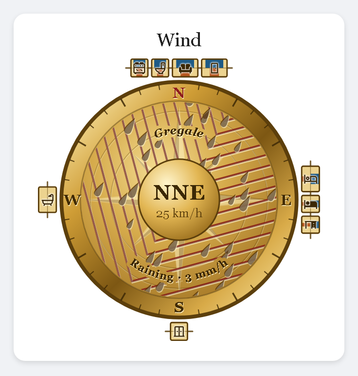
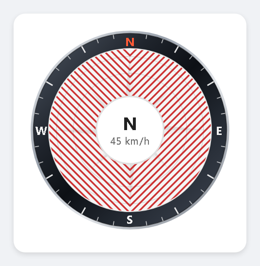
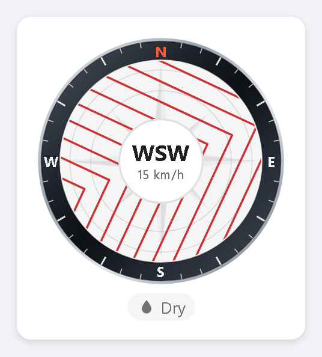
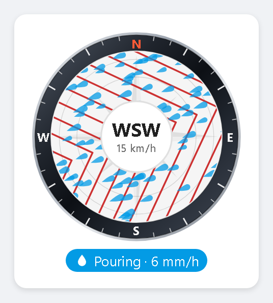
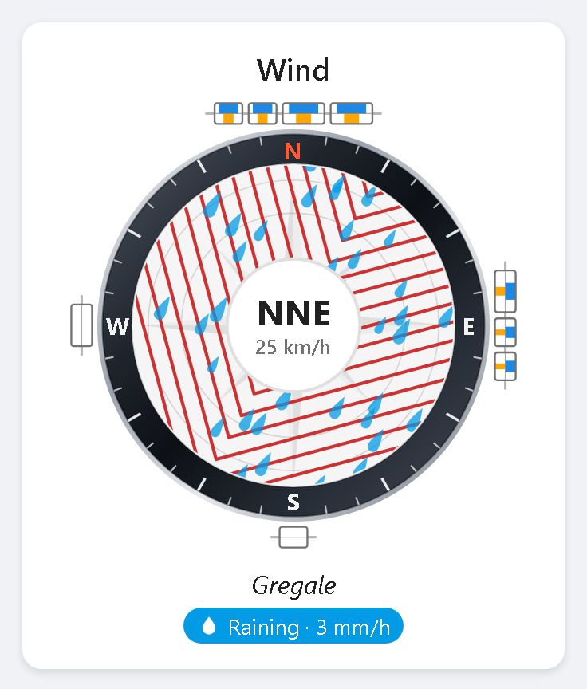
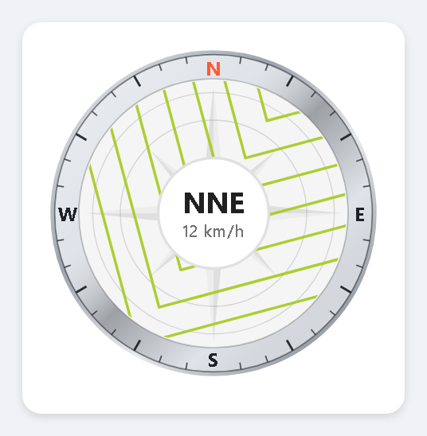
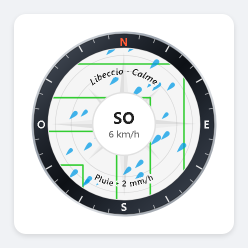
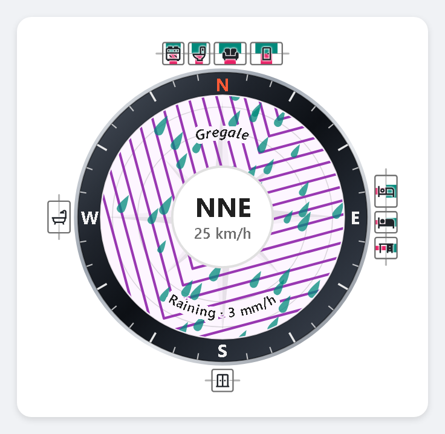

**English** · [Italiano](README.it.md) · [Deutsch](README.de.md) · [Français](README.fr.md) · [Español](README.es.md) · [Nederlands](README.nl.md)

[](https://my.home-assistant.io/redirect/marketplace_repository/?owner=Nik8003&repository=wind-compass-card&category=plugin) [](https://github.com/Nik8003/wind-compass-card/releases) [](LICENSE)

# Wind Compass Card

A Home Assistant card that shows **where the wind and the rain hit your house**: wind direction and strength, rain, and how hard each of your windows is being hit. Built for a simple use case: close the shutters when rain is blown onto the windows.

<p align="center">
  
  
</p>

## What it shows

- **Wind**: chevrons (V shapes) along the wind axis point where the wind **blows**. The stronger the wind, the denser they get; from 10 to 15 km/h they turn from green to red. The center shows where the wind comes from (e.g. **NNE**) and its speed.
- **Rain**: raindrops fly across the compass with the wind; the more it rains, the more drops. The rain is also described in words (*Drizzle*, *Raining*, *Pouring*, *Cloudburst*) with its amount.
- **Your windows**: each one sits on a wall around the compass, at its real exposure, with two gauges: the **outer half fills with blue** with the rain hitting the glass, the **inner half with orange** with the wind pushing on it. When the blue fills up, it's time to close the shutters.
- **Optional**: the traditional name of the wind (Tramontane, Gregale, Sirocco…), texts engraved in the dial, a brass style, animation, 6 languages, custom colors.

## Gallery

### Wind strength
The chevrons get denser linearly with the wind: one at 1 km/h, then more and more, up to about 45 at `max_speed`.

| 1 km/h | 8 km/h | 20 km/h | 45 km/h |
|:---:|:---:|:---:|:---:|
|  |  |  |  |

### Rain
The number of drops follows the mm/h; the text describes the rain.

| Dry | 0.5 mm/h | 2 mm/h | 6 mm/h | 12 mm/h |
|:---:|:---:|:---:|:---:|:---:|
|  |  |  |  |  |

### Windows
Windows facing the same way share a wall. Each one shows rain (outer half) and wind (inner half). Add a symbol for the room with `icon`, make them thicker with `window_thickness`, or draw them as arcs on the ring with `window_layout: ring`.

| Windows | With icons (`window_thickness: 20`) | `window_layout: ring` |
|:---:|:---:|:---:|
|  |  |  |

### Texts
Under the compass (default), or engraved in the dial with `engraved_text: true`, in a size you choose with `engraved_text_size`.

| Under the compass | Engraved | Engraved, `engraved_text_size: 1.5` |
|:---:|:---:|:---:|
|  |  |  |

### Styles and themes
The card follows Home Assistant's light and dark themes. `theme: brass` turns it into a brass instrument with engraved chevrons and drops.

| Standard, light | Standard, dark | Brass, light | Brass, dark |
|:---:|:---:|:---:|:---:|
|  |  |  |  |

### Crown colors (standard style)
`bezel_color` and `bezel_opacity`; the ticks and letters switch to white or dark by themselves to stay readable.

| Default | `#0d2a4a` | `#e0e4ea` | `#8e1b1b` | `#0d2a4a`, opacity 0.25 |
|:---:|:---:|:---:|:---:|:---:|
|  |  |  |  |  |

### Languages
English, Italian, German, French, Spanish and Dutch, chosen automatically from Home Assistant or with `language`.

| English | Italiano | Deutsch | Français | Español | Nederlands |
|:---:|:---:|:---:|:---:|:---:|:---:|
|  |  |  |  |  |  |

### More
| Minimal configuration | Classic arrow (`pointer: arrow`) | Your colors with card-mod |
|:---:|:---:|:---:|
|  |  |  |

## Installation

### Marketplace (Home Assistant 2026.11 and newer)

[](https://my.home-assistant.io/redirect/marketplace_repository/?owner=Nik8003&repository=wind-compass-card&category=plugin)

1. Click the button above, or go to **Settings → Marketplace**, choose **Add from link** (top right) and enter `https://github.com/Nik8003/wind-compass-card`.
2. Install **Wind Compass Card** (type **Dashboard**) and reload the browser.

### HACS (Home Assistant before 2026.11)

1. HACS → ⋮ → *Custom repositories* → add `https://github.com/Nik8003/wind-compass-card`, category **Dashboard**.
2. Install **Wind Compass Card** and reload the browser.

### Manual

1. Copy `dist/wind-compass-card.js` to `<config>/www/wind-compass-card.js`.
2. Settings → Dashboards → ⋮ → *Resources* → add `/local/wind-compass-card.js?v=1` as **JavaScript module**.
3. Reload the browser. After each update of the file, change `?v=1` to `?v=2`, `?v=3`… so browsers and the app load the new version.

## Configuration

Only the two wind sensors are required; everything else has a default:

```yaml
type: custom:wind-compass-card
direction_entity: sensor.wind_direction
speed_entity: sensor.wind_speed
```

Add `rain_entity` to see the rain, and `sectors` to see your windows. A fuller example:

```yaml
type: custom:wind-compass-card
name: Wind
direction_entity: sensor.wind_direction
speed_entity: sensor.wind_speed
rain_entity: sensor.rain_rate     # mm/h, mm, binary_sensor or weather
show_wind_name: true
engraved_text: true
window_thickness: 14
sectors:
  - name: Kitchen
    direction: 0     # the direction the window faces (0 = North, 90 = East)
    width: 120       # real width of the window (e.g. cm), drawn in proportion
    icon: mdi:stove  # symbol of the room: HA icon or emoji
  - name: Living room
    direction: 0
    width: 200
    icon: mdi:sofa
  - name: Bedroom
    direction: 90
    width: 120
    icon: mdi:bed
```

| Option             | Default | Description |
|--------------------|---------|-------------|
| `direction_entity` | **required** | Sensor with the wind direction in degrees: where the wind comes **from** (0 = North, 90 = East). |
| `speed_entity`     | **required** | Sensor with the wind speed (any unit). |
| `name`             |         | Card title (centered). |
| `rain_entity`      |         | `binary_sensor` (`on` = rain), numeric `sensor` (rain if > `rain_threshold`) or `weather` entity (rainy states). |
| `rain_threshold`   | `0`     | For numeric rain sensors: value above which it counts as raining. |
| `rain_levels`      | `[1, 4, 10]` | mm/h limits for describing the rain: below 1 *Drizzle*, 1–4 *Raining*, 4–10 *Pouring*, 10 and more *Cloudburst*. |
| `max_rain`         | `15`    | Rain (mm/h) that fills the compass with drops: the number of drops grows linearly up to this value. |
| `wall_rain_max`    | `5`     | Rain hitting the glass (mm/h) that fills a window's rain gauge. |
| `min_speed`        | `10`    | Wind pushing on a window from which it counts (below it, the wind gauge is faded and the card shows *Calm*). Same unit as the speed sensor. |
| `max_speed`        | `60`    | Speed at which the chevrons are densest and a window's wind gauge is full. |
| `sectors`          |         | List of windows: `name`, `direction` (where the window faces, 0–360, **required**), `width` (real width in any unit, e.g. cm, default 30), `icon` (`mdi:…` icon, emoji or letter), `exposure` (0–1, default 1: e.g. `0.5` under a balcony). |
| `window_thickness` | `10`    | Thickness of the windows (6–24). Thicker windows leave more room for their symbol. |
| `window_layout`    | `tangent` | `tangent`: windows on walls around the compass. `ring`: windows as arcs on the ring (`width` is then the arc size in degrees). |
| `show_wind_name`   | `false` | Show the traditional name of the wind: Tramontane (N), Gregale (NE), Levant (E), Sirocco (SE), Ostro (S), Libeccio (SW), Ponente (W), Mistral (NW). |
| `engraved_text`    | `false` | Engrave the texts in the dial instead of writing them under the compass: the wind's name above the center, the rain along the bottom. |
| `engraved_text_size` | `1`   | Size of the engraved texts, as a multiplier (0.5–2.5). |
| `theme`            | `default` | `brass`: polished brass bezel, engraved chevrons and drops, serif lettering. |
| `bezel_color`      |         | Standard style: color of the crown (CSS color or `[r, g, b]`). |
| `bezel_opacity`    | `1`     | Standard style: opacity of the crown, from `0` (invisible) to `1`. |
| `bezel_text_color` | auto    | Standard style: color of ticks and letters on the crown (white or dark by default, whichever reads better). |
| `motion`           | `false` | Animate the compass: drops fly with the wind, chevrons flow along its axis, faster with stronger wind. |
| `language`         | `auto`  | `auto` (as Home Assistant, English if not available), `en`, `it`, `de`, `fr`, `es`, `nl`. |
| `texts`            |         | Your own texts, replacing the built-in ones (see below). |
| `pointer`          | `chevrons` | `arrow` draws a single arrow instead of the chevrons. |
| `color`            |         | Fixed color for the chevrons or the arrow, instead of the speed-based one. |

Most options can be set with the visual editor; `sectors` and `texts` are edited in YAML. The visual editor only writes the options you change, so the YAML stays short. An option left empty or with an invalid value uses its default. Clicking the card opens the details of the speed sensor.

### How the impact on a window is computed

Any wind coming from the window's side of the house (less than 90° away from where it faces) hits it, weighted by the cosine of that angle θ: head-on counts 100%, 45° off 71%, 60° off 50%. So with wind from North-East, both North- and East-facing windows are hit.

- **Wind on the window** = wind speed × cos θ × `exposure`.
- **Rain on the glass** (driving rain, ISO 15927-3) = `0.222 × wind [m/s] × rain^0.88 [mm/h] × cos θ × exposure`. Example: 25 km/h and 2 mm/h at 45° → about 2 mm/h on the glass.

If the rain sensor gives no amount (binary sensor, weather entity), 2 mm/h is assumed (8 mm/h when *pouring*).

## Languages and custom texts

With `language: auto` the card follows Home Assistant's language. Any text can be replaced with `texts`; only what you set is replaced:

```yaml
texts:
  calm: Dead calm
  drizzle: Spitting           # below rain_levels[0]
  raining: Raining            # rain_levels[0] .. [1] (also when the sensor gives no amount)
  heavy_rain: Heavy rain      # rain_levels[1] .. [2]
  downpour: Bucketing down    # from rain_levels[2]
  dry: Dry
  unavailable: "—"
  # 16 compass points, from N clockwise
  cardinals: [N, NNE, NE, ENE, E, ESE, SE, SSE, S, SSW, SW, WSW, W, WNW, NW, NNW]
  # 8 wind names, for winds from N, NE, E, SE, S, SW, W, NW
  wind_names: [Tramontane, Gregale, Levant, Sirocco, Ostro, Libeccio, Ponente, Mistral]
```

`cardinals` must have 16 items and `wind_names` 8, otherwise they are ignored. The 4 letters on the crown are items 1, 5, 9 and 13 of `cardinals`.

## Styling (card-mod or themes)

The card reads these CSS variables, so you can restyle it with [card-mod](https://github.com/thomasloven/lovelace-card-mod) or from a Home Assistant theme:

| Variable | What it colors |
|----------|----------------|
| `--wind-compass-chevron-color` | Wind chevrons (replaces the speed-based color) |
| `--wind-compass-drop-color` | Raindrops |
| `--wind-compass-wind-color` | Wind half of the windows |
| `--wind-compass-rain-color` | Rain half of the windows and the rain badge |
| `--wind-compass-face-color` | Compass face |
| `--wind-compass-bezel-color` | Crown around the face |
| `--wind-compass-bezel-opacity` | Opacity of the crown (0–1) |
| `--wind-compass-bezel-text-color` | Ticks and letters on the crown |
| `--wind-compass-north-color` | The N on the crown |
| `--wind-compass-window-icon-color` | Room symbols on the windows |
| `--wind-compass-engraved-text-color` | Texts engraved in the dial |
| `--wind-compass-font` | Font of all texts |
| `--wind-compass-max-width` | Maximum size of the compass (e.g. `320px`) |

```yaml
card_mod:
  style: |
    ha-card {
      --wind-compass-chevron-color: #8e24aa;
      --wind-compass-rain-color: #00897b;
      --wind-compass-max-width: 320px;
      background: transparent;
      box-shadow: none;
    }
```

## Development

- `dev/demo.html`: interactive test page with sliders for wind, rain and every option (open it in a browser).
- `dev/make-screenshots.ps1`: regenerates all the images of this README with headless Chrome.

## License

MIT
