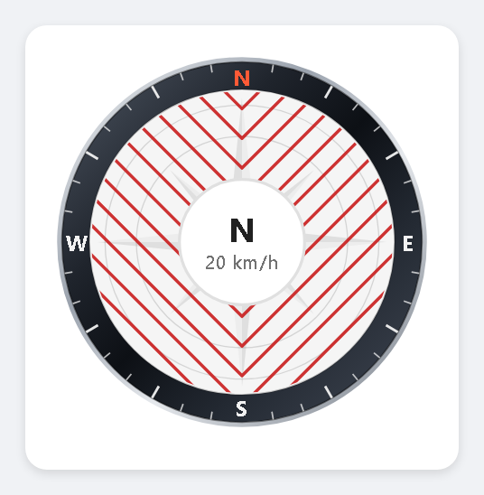
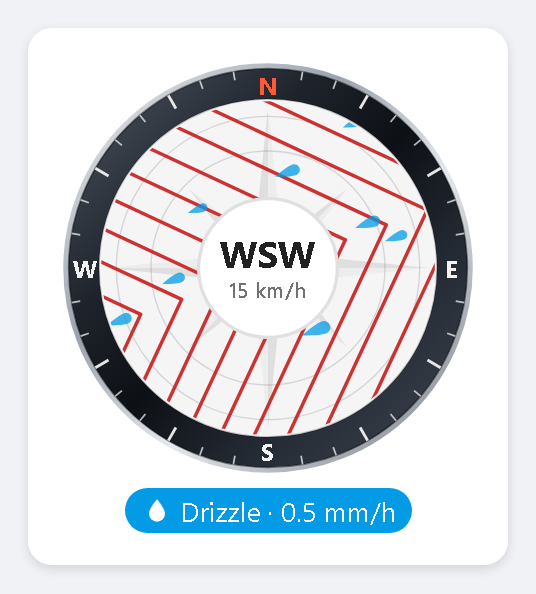
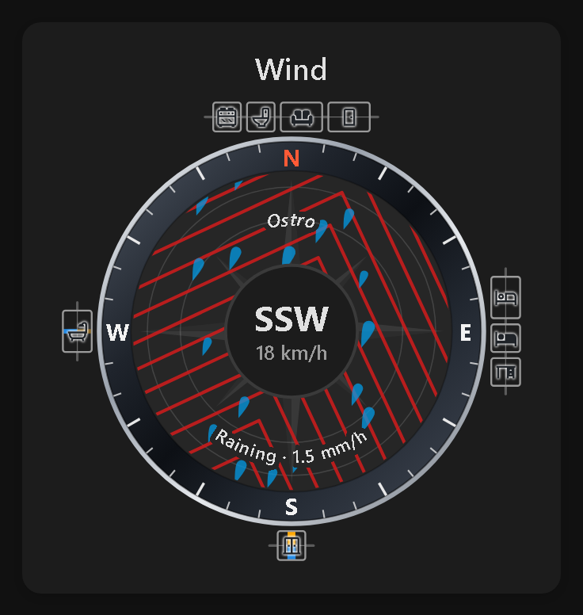
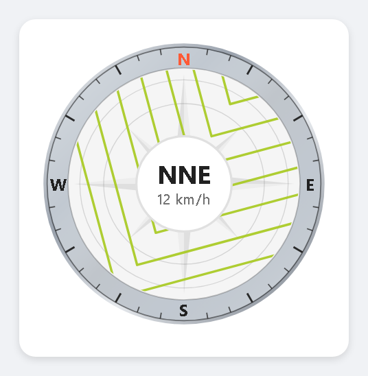
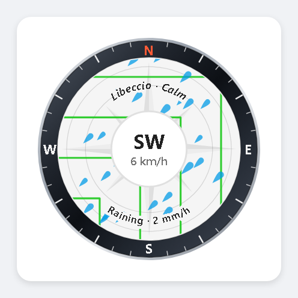
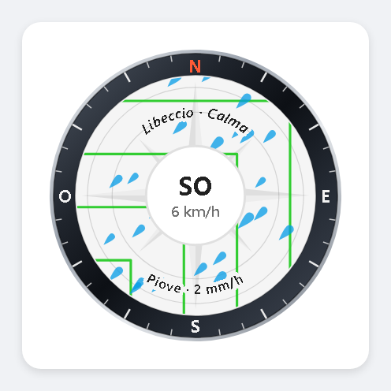

[English](README.md) · [Italiano](README.it.md) · [Deutsch](README.de.md) · [Français](README.fr.md) · [Español](README.es.md) · **Nederlands**

# Wind Compass Card

Een Home Assistant-kaart die laat zien **waar wind en regen je huis raken**: windrichting en -kracht, regen, en hoe hard elk van je ramen wordt geraakt. Ontstaan uit een eenvoudige behoefte: de rolluiken sluiten wanneer de wind de regen tegen de ramen blaast.

<p align="center">
  
  
</p>

## Wat ze laat zien

- **Wind**: punthaken (V-vormen) langs de windas wijzen waar de wind **naartoe waait**. Hoe harder de wind, hoe dichter ze op elkaar staan; tussen 10 en 15 km/h kleuren ze van groen naar rood. In het midden staan de herkomst (bijv. **NNO**) en de snelheid.
- **Regen**: regendruppels vliegen met de wind over het kompas; hoe meer regen, hoe meer druppels. De regen wordt ook in woorden beschreven (*Motregen*, *Regen*, *Stortregen*, *Wolkbreuk*) met de hoeveelheid.
- **Je ramen**: elk raam staat op een muur rond het kompas, in zijn echte ligging, met twee meters: de **buitenste helft vult zich blauw** met de regen op het glas, de **binnenste helft oranje** met de winddruk. Als het blauw vol is, is het tijd om de rolluiken te sluiten.
- **Optioneel**: de traditionele naam van de wind (Tramontana, Gregale, Scirocco…), teksten gegraveerd in de wijzerplaat, messingstijl, animatie, 6 talen, eigen kleuren.

## Galerij

### Windkracht
De punthaken worden lineair dichter met de wind: één bij 1 km/h, daarna steeds meer, tot ongeveer 45 bij `max_speed`.

| 1 km/h | 8 km/h | 20 km/h | 45 km/h |
|:---:|:---:|:---:|:---:|
|  |  |  |  |

### Regen
Het aantal druppels volgt de mm/h; de tekst beschrijft de regen.

| Droog | 0,5 mm/h | 2 mm/h | 6 mm/h | 12 mm/h |
|:---:|:---:|:---:|:---:|:---:|
|  |  |  |  |  |

### Ramen
Ramen met dezelfde ligging delen een muur. Elk raam toont regen (buitenste helft) en wind (binnenste helft). Voeg met `icon` een symbool voor de kamer toe, maak ze dikker met `window_thickness`, of teken ze als bogen op de ring met `window_layout: ring`.

| Ramen | Met iconen (`window_thickness: 20`) | `window_layout: ring` |
|:---:|:---:|:---:|
|  |  |  |

### Teksten
Onder het kompas (standaard) of gegraveerd in de wijzerplaat met `engraved_text: true`, in de grootte die je kiest met `engraved_text_size`.

| Onder het kompas | Gegraveerd | Gegraveerd, `engraved_text_size: 1.5` |
|:---:|:---:|:---:|
|  |  |  |

### Stijlen en thema's
De kaart volgt het lichte en donkere thema van Home Assistant. `theme: brass` maakt er een messing instrument van met gegraveerde punthaken en druppels.

| Standaard, licht | Standaard, donker | Messing, licht | Messing, donker |
|:---:|:---:|:---:|:---:|
|  |  |  |  |

### Kleuren van de ring (standaardstijl)
`bezel_color` en `bezel_opacity`; streepjes en letters worden vanzelf wit of donker zodat ze leesbaar blijven.

| Standaard | `#0d2a4a` | `#e0e4ea` | `#8e1b1b` | `#0d2a4a`, dekking 0.25 |
|:---:|:---:|:---:|:---:|:---:|
|  |  |  |  |  |

### Talen
Engels, Italiaans, Duits, Frans, Spaans en Nederlands, automatisch gekozen op basis van Home Assistant of met `language`.

| English | Italiano | Deutsch | Français | Español | Nederlands |
|:---:|:---:|:---:|:---:|:---:|:---:|
|  |  |  |  |  |  |

### Meer
| Minimale configuratie | Klassieke pijl (`pointer: arrow`) | Eigen kleuren met card-mod |
|:---:|:---:|:---:|
|  |  |  |

## Installatie

### HACS (aangepaste repository)

1. HACS → ⋮ → *Aangepaste repositories* → voeg de URL van deze repository toe, categorie **Dashboard**.
2. Installeer **Wind Compass Card** en herlaad de browser.

### Handmatig

1. Kopieer `dist/wind-compass-card.js` naar `<config>/www/wind-compass-card.js`.
2. Instellingen → Dashboards → ⋮ → *Bronnen* → voeg `/local/wind-compass-card.js?v=1` toe als **JavaScript-module**.
3. Herlaad de browser. Verander na elke update van het bestand `?v=1` in `?v=2`, `?v=3`… zodat browsers en de app de nieuwe versie laden.

## Configuratie

Alleen de twee windsensoren zijn verplicht; al het andere heeft een standaardwaarde:

```yaml
type: custom:wind-compass-card
direction_entity: sensor.wind_direction
speed_entity: sensor.wind_speed
```

Voeg `rain_entity` toe om de regen te zien en `sectors` om je ramen te zien. Een uitgebreider voorbeeld:

```yaml
type: custom:wind-compass-card
name: Wind
direction_entity: sensor.wind_direction
speed_entity: sensor.wind_speed
rain_entity: sensor.rain_rate     # mm/h, mm, binary_sensor of weather
show_wind_name: true
engraved_text: true
window_thickness: 14
sectors:
  - name: Keuken
    direction: 0     # ligging van het raam (0 = Noord, 90 = Oost)
    width: 120       # echte breedte van het raam (bijv. cm), op schaal getekend
    icon: mdi:stove  # symbool van de kamer: HA-icoon of emoji
  - name: Woonkamer
    direction: 0
    width: 200
    icon: mdi:sofa
  - name: Slaapkamer
    direction: 90
    width: 120
    icon: mdi:bed
```

| Optie              | Standaard | Beschrijving |
|--------------------|-----------|-------------|
| `direction_entity` | **verplicht** | Sensor van de windrichting in graden: waar de wind **vandaan komt** (0 = Noord, 90 = Oost). |
| `speed_entity`     | **verplicht** | Sensor van de windsnelheid (elke eenheid). |
| `name`             |           | Titel van de kaart (gecentreerd). |
| `rain_entity`      |           | `binary_sensor` (`on` = regen), numerieke `sensor` (regen als > `rain_threshold`) of `weather`-entiteit (regenachtige toestanden). |
| `rain_threshold`   | `0`       | Voor numerieke regensensoren: waarde waarboven het als regen telt. |
| `rain_levels`      | `[1, 4, 10]` | Grenzen in mm/h om de regen te beschrijven: onder 1 *Motregen*, 1–4 *Regen*, 4–10 *Stortregen*, vanaf 10 *Wolkbreuk*. |
| `max_rain`         | `15`      | Regen (mm/h) die het kompas met druppels vult: het aantal druppels groeit lineair tot deze waarde. |
| `wall_rain_max`    | `5`       | Regen op het glas (mm/h) die de regenmeter van een raam vult. |
| `min_speed`        | `10`      | Winddruk op een raam vanaf wanneer die telt (daaronder is de windmeter vaag en toont de kaart *Windstil*). Dezelfde eenheid als de sensor. |
| `max_speed`        | `60`      | Snelheid waarbij de punthaken het dichtst staan en de windmeter van een raam vol is. |
| `sectors`          |           | Lijst van ramen: `name`, `direction` (ligging, 0–360, **verplicht**), `width` (echte breedte in elke eenheid, bijv. cm, standaard 30), `icon` (`mdi:…`-icoon, emoji of letter), `exposure` (0–1, standaard 1: bijv. `0.5` onder een balkon). |
| `window_thickness` | `10`      | Dikte van de ramen (6–24). Dikkere ramen laten meer ruimte voor het symbool. |
| `window_layout`    | `tangent` | `tangent`: ramen op muren rond het kompas. `ring`: ramen als bogen op de ring (`width` is dan de grootte van de boog in graden). |
| `show_wind_name`   | `false`   | Toont de traditionele naam van de wind: Tramontana (N), Gregale (NO), Levante (O), Scirocco (ZO), Ostro (Z), Libeccio (ZW), Ponente (W), Mistral (NW). |
| `engraved_text`    | `false`   | Graveert de teksten in de wijzerplaat in plaats van ze onder het kompas te schrijven: de naam van de wind boven het midden, de regen langs de onderkant. |
| `engraved_text_size` | `1`     | Grootte van de gegraveerde teksten, als factor (0.5–2.5). |
| `theme`            | `default` | `brass`: gepolijste messing ring, gegraveerde punthaken en druppels, schreeflettertype. |
| `bezel_color`      |           | Standaardstijl: kleur van de ring (CSS-kleur of `[r, g, b]`). |
| `bezel_opacity`    | `1`       | Standaardstijl: dekking van de ring, van `0` (onzichtbaar) tot `1`. |
| `bezel_text_color` | auto      | Standaardstijl: kleur van streepjes en letters (standaard wit of donker, wat het best leesbaar is). |
| `motion`           | `false`   | Animeert het kompas: druppels vliegen met de wind, punthaken stromen langs de as, sneller bij harde wind. |
| `language`         | `auto`    | `auto` (zoals Home Assistant, Engels indien niet beschikbaar), `en`, `it`, `de`, `fr`, `es`, `nl`. |
| `texts`            |           | Eigen teksten in plaats van de ingebouwde (zie hieronder). |
| `pointer`          | `chevrons` | `arrow` tekent een pijl in plaats van de punthaken. |
| `color`            |           | Vaste kleur voor de punthaken of de pijl, in plaats van de snelheidsafhankelijke. |

De meeste opties zijn in te stellen in de visuele editor; `sectors` en `texts` bewerk je in YAML. De visuele editor schrijft alleen de opties die je wijzigt, zodat de YAML kort blijft. Een lege of ongeldige optie gebruikt de standaardwaarde. Klikken op de kaart opent de details van de snelheidssensor.

### Hoe de impact op een raam wordt berekend

Elke wind van de kant van het raam (minder dan 90° van zijn ligging) raakt het, gewogen met de cosinus van de hoek θ: recht van voren telt 100 %, 45° ernaast 71 %, 60° ernaast 50 %. Bij wind uit het noordoosten worden dus zowel noord- als oostramen geraakt.

- **Wind op het raam** = windsnelheid × cos θ × `exposure`.
- **Regen op het glas** (slagregen, ISO 15927-3) = `0,222 × wind [m/s] × regen^0,88 [mm/h] × cos θ × exposure`. Voorbeeld: 25 km/h en 2 mm/h onder 45° → ongeveer 2 mm/h op het glas.

Als de regensensor geen hoeveelheid geeft (binary sensor, weerentiteit), wordt 2 mm/h aangenomen (8 mm/h bij *pouring*).

## Talen en eigen teksten

Met `language: auto` volgt de kaart de taal van Home Assistant. Elke tekst kan worden vervangen met `texts`; alleen wat je opgeeft wordt vervangen:

```yaml
texts:
  calm: Bladstil
  drizzle: Miezer             # onder rain_levels[0]
  raining: Regen              # van rain_levels[0] tot [1] (ook als de sensor geen hoeveelheid geeft)
  heavy_rain: Zware regen     # van rain_levels[1] tot [2]
  downpour: Het giet          # vanaf rain_levels[2]
  dry: Droog
  unavailable: "—"
  # 16 windrichtingen, vanaf N met de klok mee
  cardinals: [N, NNO, NO, ONO, O, OZO, ZO, ZZO, Z, ZZW, ZW, WZW, W, WNW, NW, NNW]
  # 8 windnamen, voor wind uit N, NO, O, ZO, Z, ZW, W, NW
  wind_names: [Tramontana, Gregale, Levante, Scirocco, Ostro, Libeccio, Ponente, Mistral]
```

`cardinals` moet 16 items hebben en `wind_names` 8, anders worden ze genegeerd. De 4 letters op de ring zijn items 1, 5, 9 en 13 van `cardinals`.

## Opmaak (card-mod of thema's)

De kaart leest deze CSS-variabelen, dus je kunt haar opmaken met [card-mod](https://github.com/thomasloven/lovelace-card-mod) of een Home Assistant-thema:

| Variabele | Wat ze kleurt |
|----------|---------------|
| `--wind-compass-chevron-color` | Windpunthaken (in plaats van de snelheidsafhankelijke kleur) |
| `--wind-compass-drop-color` | Regendruppels |
| `--wind-compass-wind-color` | Windhelft van de ramen |
| `--wind-compass-rain-color` | Regenhelft van de ramen en de regenbadge |
| `--wind-compass-face-color` | Wijzerplaat |
| `--wind-compass-bezel-color` | Ring rond de wijzerplaat |
| `--wind-compass-bezel-opacity` | Dekking van de ring (0–1) |
| `--wind-compass-bezel-text-color` | Streepjes en letters op de ring |
| `--wind-compass-north-color` | De N op de ring |
| `--wind-compass-window-icon-color` | Kamersymbolen op de ramen |
| `--wind-compass-engraved-text-color` | Teksten gegraveerd in de wijzerplaat |
| `--wind-compass-font` | Lettertype van alle teksten |
| `--wind-compass-max-width` | Maximale grootte van het kompas (bijv. `320px`) |

```yaml
card_mod:
  style: |
    ha-card {
      --wind-compass-chevron-color: #8e24aa;
      --wind-compass-rain-color: #00897b;
      --wind-compass-max-width: 320px;
      background: transparent;
      box-shadow: none;
    }
```

## Ontwikkeling

- `dev/demo.html`: interactieve testpagina met schuifregelaars voor wind, regen en alle opties (open in een browser).
- `dev/make-screenshots.ps1`: maakt alle afbeeldingen van deze README opnieuw met headless Chrome.

## Licentie

MIT
